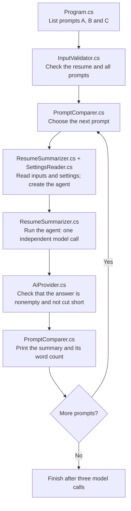

# Prompt Engineering: one small experiment

Prompt engineering means changing the instructions you give the AI to influence its answer. Here, the AI summarizes one fictional resume three times, with a different instruction each time. **Program.cs** lists the prompts and starts the comparison. **InputValidator.cs** checks the source files, **PromptComparer.cs** runs the loop and prints word counts, and **ResumeSummarizer.cs** sends each request through Microsoft Agent Framework. An agent holds the shared instructions and generation settings and calls the selected model.

| Prompt file | Concept |
| --- | --- |
| [A-zero-shot.txt](Prompts/A-zero-shot.txt) | Zero-shot: ask for a summary without showing an example. |
| [B-few-shot.txt](Prompts/B-few-shot.txt) | Few-shot: show two example summaries so the AI can follow their style. |
| [C-constrained.txt](Prompts/C-constrained.txt) | Constrained: allow at most 70 words and require every fact to come from the resume. |

All three requests also receive the same system instruction in ResumeSummarizer.cs. This sets rules for every case: use only the candidate's resume facts and return one paragraph. The examples show how to write; their facts do not belong to the candidate. Each request starts a fresh conversation, so earlier summaries do not influence later ones. The resume, model, and generation settings stay the same; only the instruction from the prompt file changes.

## Execution flow

Follow the arrows from top to bottom. InputValidator.cs checks every input file before the loop starts. PromptComparer.cs then runs once for A, once for B, and once for C. ResumeSummarizer.cs reads the shared settings through SettingsReader.cs before each model request.



Each pass uses the same resume, model, and settings with a fresh conversation. ResumeSummarizer.cs creates a `ChatClientAgent` and calls `RunAsync` without a saved conversation session, so earlier summaries are not sent to the next request. The agent uses the shared instruction as a system message and the prompt plus resume as a user message. A missing input, failed request, or rejected response stops the program before the later prompts run.

The [shared retry policy](../../shared/shared/AiRetryPolicy.cs) can resend a temporary HTTP failure twice inside one agent call. It keeps the same prompt and settings; the comparison loop advances only after a usable answer.

## Run

Install the .NET 10 SDK. All projects use one settings file: `shared/shared/.env` in the repository root. If it is missing, copy [shared/shared/.env.example](../../shared/shared/.env.example) to that path. Choose an AI provider with `AI_PROVIDER`, then configure its API key and model using the [shared setup instructions](../../shared/shared/README.md#run). Only the selected provider's values are required. Rebuild after changing the settings.

Then run from this folder:

```sh
dotnet run
```

You can also run the project in Visual Studio. A build copies the resume, prompt files, and shared settings into the folder containing the executable. The program reads those copies. Edit the original files in the project folder and rebuild to try your changes. The first build downloads the packages if needed.

[SettingsReader.cs](../../shared/shared/SettingsReader.cs) reads the copied settings file, and [AiProvider.cs](../../shared/shared/AiProvider.cs) creates the SDK client; Git ignores your `.env` file. ResumeSummarizer.cs adapts that client with `AsIChatClient` and uses Microsoft Agent Framework to send each request. It prints the selected model and provider. Each run makes **three model calls**, one per prompt: normally three real HTTP requests and at most **nine HTTP attempts** with retries. They send the fictional resume to the selected AI provider and may charge your account. Each call allows up to 2,048 output tokens, the small pieces of text counted by the model. The code requests temperature 0.2 for all three calls; models that support this setting use it to control variation in the generated text. Each call has a 120-second total deadline, including retry waits and attempts. The code leaves `top_p`, another generation setting, unset because some providers reject it.

Gemini 3.6 and newer models currently ignore custom temperature values. Google recommends omitting that parameter and says it will become an error in a future release. This experiment keeps its declared settings fixed, so choose a compatible model when temperature control matters. See [Gemini's parameter guidance](https://ai.google.dev/gemini-api/docs/troubleshooting#recitation-issue).

Configure an available chat model for the selected provider. If you see HTTP 429, the provider is limiting requests, has no remaining quota, or is too busy. Wait and try again, or check your quota and model in `shared/shared/.env`. See [OpenRouter's rate limit guidance](https://openrouter.ai/docs/api_reference/limits#handling-429-errors) or [Gemini's rate limits](https://ai.google.dev/gemini-api/docs/rate-limits).

Use a model that supports chat completions and the requested settings. If a request fails, the program prints the error and any available provider details. After changing `shared/shared/.env`, stop any running debugging session and rebuild so the program receives the new settings.

Some reasoning models spend output tokens on thinking as well as on the final answer. A short summary can therefore need more than 200 output tokens. The program rejects an empty answer or one cut short by the output limit. InputValidator.cs checks every prompt file before the comparison starts, so missing inputs are found early. SettingsReader.cs checks the shared settings when ResumeSummarizer.cs prepares each request. See [OpenRouter's explanation](https://openrouter.ai/docs/guides/best-practices/reasoning-tokens#reasoning-tokens-and-max_tokens).

## Understand the results

PromptComparer.cs prints each summary under its prompt name, followed by its word count. Compare A, B, and C with the same resume. All three requests ask for one paragraph; C also asks for at most 70 words.

A message such as `HTTP 503. Retry 1/2 in 2.3 seconds.` means the shared policy will send the same request again. No retry message appears when the first attempt succeeds. See the [shared retry explanation](../../shared/shared/README.md#understand-the-results) for delays and failures after the attempt limit.

The word counter splits text at spaces, tabs, and line breaks. It helps you check the 70-word limit. You still need to read the summaries to judge whether the facts are correct and useful. The model can produce different wording even when you keep all inputs the same.

## Learn by changing a prompt

1. Read A, B, and C. Predict how the examples and the word limit might change the summaries.
2. Run the program and compare each summary with [the resume](resume.md). Look at both the wording and the facts it chose.
3. Check whether C stayed within 70 words. For B, check whether the AI copied a fact from an example that does not appear in the candidate's resume.
4. Change one prompt and run again. Each run makes another three model calls, with up to nine HTTP attempts. Keep the resume, model, and settings fixed so you can study the effect of that change.

## Files to read

```text
Program.cs                                    Prompt list and main execution flow
InputValidator.cs                             Source-file checks before the comparison
PromptComparer.cs                             Comparison loop, printed summaries, and word counts
ResumeSummarizer.cs                           Agent setup, independent summary request, and response checks
../../shared/shared/SettingsReader.cs         Shared provider selection and settings parsing
../../shared/shared/AiProvider.cs             Shared provider setup, response checks, and API errors
../../shared/shared/AiRetryPolicy.cs          Shared HTTP retries and retry messages
../../shared/shared/ProviderSettings.cs       Selected provider connection values
../../shared/shared.tests/AiProviderTests.cs  Shared client setup and response checks
../../shared/shared/.env                      Provider selection, keys, and models
../../shared/shared/.env.example              Template for creating the shared settings
Prompts/A-zero-shot.txt                       Direct instruction
Prompts/B-few-shot.txt                        Instruction with examples
Prompts/C-constrained.txt                     Instruction with constraints
resume.md                                     The fictional source
prompt-engineering.csproj                     .NET 10 project, Agent Framework dependencies, and shared reference
```

Start by reading Program.cs from top to bottom. Follow its calls to InputValidator.cs and PromptComparer.cs, then read the request in ResumeSummarizer.cs. Run the comparison and use the printed summaries and word counts to see how the three instructions affect the answer.

## Tests

The solution includes `prompt-engineering.tests`, a small [xUnit project](https://xunit.net/docs/getting-started/v2/getting-started) with five cases. Each test file matches the source file it checks.

| Test file | Checks |
| --- | --- |
| [InputValidatorTests.cs](../prompt-engineering.tests/InputValidatorTests.cs) | Two local cases reject missing and empty prompts before any request. |
| [ResumeSummarizerTests.cs](../prompt-engineering.tests/ResumeSummarizerTests.cs) | Three integration cases check a nonempty paragraph and the constrained prompt's word limit. |

The integration tests call `ResumeSummarizer.SummarizeAsync`, just like the console app, and use the same settings, resume, and prompts copied into the test output folder through the project reference. Common settings and response checks are tested separately in [shared.tests](../../shared/shared.tests/shared.tests.csproj).

From the repository root, run:

```sh
dotnet test 01-prompt-engineering/prompt-engineering.tests/prompt-engineering.tests.csproj
```

You can also use Visual Studio's Test Explorer. A complete test run makes **three model calls**, normally three real HTTP requests and up to **nine HTTP attempts** with retries. The integration cases require a nonempty summary with no blank lines between paragraphs; C must also stay within 70 words. The summaries and word counts appear in test output. Missing settings or API errors fail the tests. A busy provider can cause a failure even when the code is working, and a model can miss a formatting rule on a later run. Read the answers yourself to judge factual accuracy and whether the examples influenced their style.

References: [Microsoft Agent Framework model providers](https://learn.microsoft.com/en-us/agent-framework/integrations/by-component/model-providers/openai), [official OpenAI .NET SDK](https://github.com/openai/openai-dotnet), [OpenRouter Chat Completions](https://openrouter.ai/docs/api/api-reference/chat/create-a-chat-completion), and [Gemini OpenAI compatibility](https://ai.google.dev/gemini-api/docs/openai).
