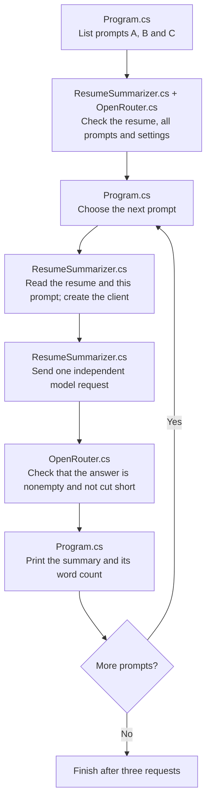

# Prompt Engineering: one small experiment

Prompt engineering means changing the instructions you give the AI to influence its answer. Here, the AI summarizes one fictional resume three times, with a different instruction each time. **Program.cs** runs the comparison and prints the word counts; **ResumeSummarizer.cs** sends each request to the model.

| Prompt file | Concept |
| --- | --- |
| [A-zero-shot.txt](prompts/A-zero-shot.txt) | Zero-shot: ask for a summary without showing an example. |
| [B-few-shot.txt](prompts/B-few-shot.txt) | Few-shot: show two example summaries so the AI can follow their style. |
| [C-constrained.txt](prompts/C-constrained.txt) | Constrained: allow at most 70 words and require every fact to come from the resume. |

All three requests also receive the same system instruction in ResumeSummarizer.cs. This sets rules for every case: use only the candidate's resume facts and return one paragraph. The examples show how to write; their facts do not belong to the candidate. Each request starts a fresh conversation, so earlier summaries do not influence later ones. The resume, model, and generation settings stay the same; only the instruction from the prompt file changes.

## Execution flow

Follow the arrows from top to bottom. The loop runs once for A, once for B, and once for C. All input files and shared settings are checked before the first model request.



Each pass uses the same resume, model, and settings with a fresh conversation. A missing input, failed request, or rejected response stops the program before the later prompts run.

## Run

Install the .NET 10 SDK. All projects use one settings file: `shared/shared/.env` in the repository root. If it is missing, copy [shared/shared/.env.example](../../shared/shared/.env.example) to that path. Fill in your OpenRouter key and the ID of a model you can use, without quotes:

```dotenv
OPENROUTER_API_KEY=your-key
OPENROUTER_MODEL=your-model-id
```

Then run from this folder:

```sh
dotnet run
```

You can also run the project in Visual Studio. A build copies the resume, prompt files, and shared settings into the folder containing the executable. The program reads those copies. Edit the original files in the project folder and rebuild to try your changes. The first build downloads the packages if needed.

[OpenRouter.cs](../../shared/shared/OpenRouter.cs) reads the copied settings file; Git ignores your `.env` file. ResumeSummarizer.cs prints the selected model. Each run makes **three real API requests**, one per prompt, sending the fictional resume to OpenRouter and its remote provider. These requests may charge your account. Each allows up to 2,048 output tokens, the small pieces of text counted by the model. Temperature controls variation in the generated text; it stays at 0.2 for all three requests. Each request has a 120-second deadline, and automatic retries are disabled. The code leaves `top_p`, another generation setting, unset because some providers reject it.

Set `OPENROUTER_MODEL` to an available chat model ID. If you see HTTP 429, OpenRouter or the provider is limiting requests or is too busy. This can happen even when your free quota has requests left. Wait and try again, or change the model in `shared/shared/.env`. See [OpenRouter's rate limit guidance](https://openrouter.ai/docs/api_reference/limits#handling-429-errors).

Use a model that supports chat completions and the requested settings. If a request fails, the program prints the error and any available provider details. After changing `shared/shared/.env`, stop any running debugging session and rebuild so the program receives the new settings.

Some reasoning models spend output tokens on thinking as well as on the final answer. A short summary can therefore need more than 200 output tokens. The program rejects an empty answer or one cut short by the output limit. Program.cs checks every prompt file and the shared settings before the first request, so missing inputs are found early. See [OpenRouter's explanation](https://openrouter.ai/docs/guides/best-practices/reasoning-tokens#reasoning-tokens-and-max_tokens).

## Understand the results

Program.cs prints each summary under its prompt name, followed by its word count. Compare A, B, and C with the same resume. All three requests ask for one paragraph; C also asks for at most 70 words.

The word counter splits text at spaces, tabs, and line breaks. It helps you check the 70-word limit. You still need to read the summaries to judge whether the facts are correct and useful. The model can produce different wording even when you keep all inputs the same.

## Learn by changing a prompt

1. Read A, B, and C. Predict how the examples and the word limit might change the summaries.
2. Run the program and compare each summary with [the resume](resume.md). Look at both the wording and the facts it chose.
3. Check whether C stayed within 70 words. For B, check whether the AI copied a fact from an example that does not appear in the candidate's resume.
4. Change one prompt and run again. Each run makes another three requests. Keep the resume, model, and settings fixed so you can study the effect of that change.

## Files to read

```text
Program.cs                                    Console comparison loop
ResumeSummarizer.cs                           Shared summary request method
../../shared/shared/OpenRouter.cs             Shared configuration, response checks, and API errors
../../shared/shared.tests/OpenRouterTests.cs  Shared plumbing checks in shared.tests
../../shared/shared/.env                      Your OpenRouter key and model
../../shared/shared/.env.example              Template for creating the shared settings
prompts/A-zero-shot.txt                       Direct instruction
prompts/B-few-shot.txt                        Instruction with examples
prompts/C-constrained.txt                     Instruction with constraints
resume.md                                     The fictional source
prompt-engineering.csproj                     .NET 10 project, SDK dependency, and shared reference
```

Start by reading Program.cs from top to bottom, then follow its call to ResumeSummarizer.cs. Run the comparison and use the printed summaries and word counts to see how the three instructions affect the answer.

## Tests

The solution includes `prompt-engineering.tests`, a small [xUnit project](https://xunit.net/docs/getting-started/v2/getting-started). [PromptTests.cs](../prompt-engineering.tests/PromptTests.cs) contains four cases. Three ask the real model for a summary; these are integration tests. The fourth checks locally that a missing prompt is rejected before any request. The integration tests call `ResumeSummarizer.SummarizeAsync`, just like the console app, and use the same settings, resume, and prompts copied into the test output folder through the project reference. Common settings and response checks are tested separately in [shared.tests](../../shared/shared.tests/shared.tests.csproj).

From the repository root, run:

```sh
dotnet test 01-prompt-engineering/prompt-engineering.tests/prompt-engineering.tests.csproj
```

You can also use Visual Studio's Test Explorer. A complete test run makes **three real API requests**. The integration cases require a nonempty summary with no blank lines between paragraphs; C must also stay within 70 words. The summaries and word counts appear in test output. Missing settings or API errors fail the tests. A busy provider can cause a failure even when the code is working, and a model can miss a formatting rule on a later run. Read the answers yourself to judge factual accuracy and whether the examples influenced their style.

References: [official OpenAI .NET SDK](https://github.com/openai/openai-dotnet) and [OpenRouter Chat Completions](https://openrouter.ai/docs/api/api-reference/chat/create-a-chat-completion).
