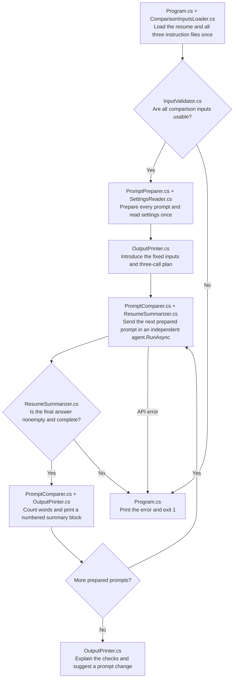

# Prompt Engineering: one small experiment

Prompt engineering means changing the instructions you give the AI to influence its answer. Here, the AI summarizes one fictional resume three times, with a different instruction each time. **Program.cs** shows loading, validation, preparation, comparison, and presentation in order. **ComparisonInputsLoader.cs** reads every file once, **InputValidator.cs** checks the complete comparison, and **PromptPreparer.cs** builds all three prompts before requests begin. **PromptComparer.cs** runs the comparison and counts words. **ResumeSummarizer.cs** constructs the native agent and checks its response. **OutputPrinter.cs** explains the lesson and prints numbered summaries.

| Prompt file | Concept |
| --- | --- |
| [A-zero-shot.txt](Prompts/A-zero-shot.txt) | Zero-shot: ask for a summary without showing an example. |
| [B-few-shot.txt](Prompts/B-few-shot.txt) | Few-shot: show two example summaries so the AI can follow their style. |
| [C-constrained.txt](Prompts/C-constrained.txt) | Constrained: allow at most 70 words and require every fact to come from the resume. |

All three requests also receive the same system instruction in ResumeSummarizer.cs. This sets rules for every case: use only the candidate's resume facts and return one paragraph. The examples show how to write; their facts do not belong to the candidate. Each request starts a fresh conversation, so earlier summaries do not influence later ones. The resume, model, and generation settings stay the same; only the instruction from the prompt file changes.

## Execution flow

Follow the arrows from top to bottom. Program.cs groups the lesson into preparation, comparison, and takeaway chapters, with numbered steps in each. All instructions and one resume snapshot are loaded and validated before PromptPreparer.cs builds every complete prompt. SettingsReader.cs reads the selected connection once before the comparison starts. Later requests receive only prepared text and that same ProviderSettings record; they do not reopen source files or settings.



PromptFile records name input files. PromptCase records hold loaded instructions, ComparisonInputs keeps them beside the shared resume, and PreparedPrompt records contain the complete request text. Each public record has its own file under Types/. Preparation makes zero model requests.

ResumeSummarizer.cs declares the system instruction, temperature, and output limit in ChatOptions. It gets an IChatClient from [AiClientFactory.cs](../../shared/shared/AiClientFactory.cs), constructs a ChatClientAgent, and calls RunAsync directly. Each request starts a fresh conversation with the same system instruction and its own prepared user prompt. A linked CancellationTokenSource covers the complete call and its HTTP retries. Native finish-reason and final-text checks reject empty or cut-short answers before word counting.

The [shared retry policy](../../shared/shared/Providers/AiRetryPolicy.cs) can resend a temporary HTTP failure twice inside one agent call. It keeps the same prepared prompt and settings. Input failures stop before the first request; request or response failures stop before later cases run.

## Run

Install the .NET 10 SDK. All projects use one settings file: `shared/shared/.env` in the repository root. If it is missing, copy [shared/shared/.env.example](../../shared/shared/.env.example) to that path. Choose an AI provider with `AI_PROVIDER`, then configure its API key and model using the [shared setup instructions](../../shared/shared/README.md#run). Only the selected provider's values are required. Rebuild after changing the settings.

Then run from this folder:

```sh
dotnet run
```

You can also run the project in Visual Studio. A build copies the resume, prompt files, and shared settings into the folder containing the executable. The program reads those copies. Edit the original files in the project folder and rebuild to try your changes. The first build downloads the packages if needed.

[SettingsReader.cs](../../shared/shared/SettingsReader.cs) reads the copied settings file; Git ignores your `.env` file. ResumeSummarizer.cs constructs the agent directly and uses [AiClientFactory.cs](../../shared/shared/AiClientFactory.cs) for provider connections and compatibility. Changing the selected provider or model requires no lesson code changes. The lesson prints the selected model and provider. Each run makes **three model calls**, one per prompt: normally three real HTTP requests and at most **nine HTTP attempts** with retries. They send the fictional resume to the selected AI provider and may charge your account. Each call allows up to 2,048 output tokens, the small pieces of text counted by the model. The code requests temperature 0.2 for all three calls; models that support this setting use it to control variation in the generated text. Each call has a 120-second total deadline, including retry waits and attempts. The code leaves `top_p`, another generation setting, unset because some providers reject it.

Gemini 3.6 and newer models currently ignore custom temperature values. Google recommends omitting that parameter and says it will become an error in a future release. This experiment keeps its declared settings fixed, so choose a compatible model when temperature control matters. See [Gemini's parameter guidance](https://ai.google.dev/gemini-api/docs/troubleshooting#recitation-issue).

Configure an available chat model for the selected provider. If you see HTTP 429, the provider is limiting requests, has no remaining quota, or is too busy. Wait and try again, or check your quota and model in `shared/shared/.env`. See [OpenRouter's rate limit guidance](https://openrouter.ai/docs/api_reference/limits#handling-429-errors) or [Gemini's rate limits](https://ai.google.dev/gemini-api/docs/rate-limits).

Use a model that supports chat completions and the requested settings. If a request fails, the program prints the error and any available provider details. After changing `shared/shared/.env`, stop any running debugging session and rebuild so the program receives the new settings.

Some reasoning models spend output tokens on thinking as well as on the final answer. A short summary can therefore need more than 200 output tokens. The program rejects an empty answer or one cut short by the output limit. The loader reads every prompt file and InputValidator.cs checks all loaded instructions before the comparison starts, so missing inputs are found early. Program.cs reads and checks the shared settings once before the first request. See [OpenRouter's explanation](https://openrouter.ai/docs/guides/best-practices/reasoning-tokens#reasoning-tokens-and-max_tokens).

## Understand the results

OutputPrinter.cs introduces the three prompt styles and prints each summary under its prompt name, followed by the word count calculated in PromptComparer.cs. Compare A, B, and C with the same resume. All three requests ask for one paragraph; C also asks for at most 70 words. The final takeaway reminds you to check facts against the resume and try changing one prompt.

Green headings separate stages, white dividers number summaries from 1, cyan identifies each prompt, and dark yellow identifies word counts. Model details appear in grey. The shared ConsoleOutput.cs helper restores the original console colour after each message. Redirected output stays plain text, with the same labels and answers.

A message such as `HTTP 503. Retry 1/2 in 2.3 seconds.` means the shared policy will send the same request again. No retry message appears when the first attempt succeeds. See the [shared retry explanation](../../shared/shared/README.md#understand-the-results) for delays and failures after the attempt limit.

The word counter splits text at spaces, tabs, and line breaks. It helps you check the 70-word limit. You still need to read the summaries to judge whether the facts are correct and useful. The model can produce different wording even when you keep all inputs the same.

## Learn by changing a prompt

1. Read A, B, and C. Predict how the examples and the word limit might change the summaries.
2. Run the program and compare each summary with [the resume](resume.md). Look at both the wording and the facts it chose.
3. Check whether C stayed within 70 words. For B, check whether the AI copied a fact from an example that does not appear in the candidate's resume.
4. Change one prompt and run again. Each run makes another three model calls, with up to nine HTTP attempts. Keep the resume, model, and settings fixed so you can study the effect of that change.

## Files to read

```text
Program.cs                                    Explicit preparation, comparison, and takeaway chapters
ComparisonInputsLoader.cs                     Read every source file once
PromptPreparer.cs                             Build all complete prompts before paid work
Types/PromptFile.cs                            Named input file
Types/PromptCase.cs                            Loaded instruction with its label and filename
Types/ComparisonInputs.cs                      One resume snapshot and every comparison case
Types/PreparedPrompt.cs                        Complete immutable request text
InputValidator.cs                             Validate the complete loaded comparison
PromptComparer.cs                             Comparison loop and word counts
OutputPrinter.cs                              Introduction, labelled summaries, and learning takeaway
ResumeSummarizer.cs                           Native agent, prompts, settings, and independent RunAsync call
../../shared/shared/ConsoleOutput.cs          Shared headings and terminal colour handling
../../shared/shared/SettingsReader.cs         Shared provider selection and settings parsing
../../shared/shared/AiClientFactory.cs        Provider client construction and compatibility
../../shared/shared/Providers/AiRetryPolicy.cs  Internal bounded HTTP retry policy
../../shared/shared/ProviderSettings.cs       Selected provider connection values
../../shared/shared.tests/AiClientFactoryTests.cs  Native requests and provider compatibility
../../shared/shared/.env                      Provider selection, keys, and models
../../shared/shared/.env.example              Template for creating the shared settings
Prompts/A-zero-shot.txt                       Direct instruction
Prompts/B-few-shot.txt                        Instruction with examples
Prompts/C-constrained.txt                     Instruction with constraints
resume.md                                     The fictional source
prompt-engineering.csproj                     .NET 10 project, copied inputs, and shared reference
```

Start with Program.cs and follow loading, validation, prompt preparation, and comparison in order. Then read the native request in ResumeSummarizer.cs. Run the comparison and use the printed summaries and word counts to see how the three instructions affect the answer.

## Tests

The xUnit project contains **14 cases: 11 deterministic cases and three integration cases**. Counterpart files own the behavior they check.

| Test file | Checks |
| --- | --- |
| [ComparisonInputsLoaderTests.cs](../prompt-engineering.tests/ComparisonInputsLoaderTests.cs) | A missing later prompt fails during loading. |
| [InputValidatorTests.cs](../prompt-engineering.tests/InputValidatorTests.cs) | Empty resumes and later empty instructions are rejected. |
| [PromptPreparerTests.cs](../prompt-engineering.tests/PromptPreparerTests.cs) | Every prompt contains its original instruction and the same unchanged resume. |
| [PromptComparerTests.cs](../prompt-engineering.tests/PromptComparerTests.cs) | Invalid later inputs send zero HTTP requests; prepared cases produce three independent native requests. |
| [ResumeSummarizerTests.cs](../prompt-engineering.tests/ResumeSummarizerTests.cs) | Scripted HTTP checks empty/truncated answers and cancellation. Three live cases check paragraph format and C's 70-word limit. |

TestData/PromptTestData.cs supplies fresh copied inputs and completes the same loading, validation, and preparation steps as Program.cs. SummaryResponseHandler.cs replaces only HTTP for local checks. Every integration case prepares the entire comparison before selecting its one request. Shared configuration and transport checks remain in [shared.tests](../../shared/shared.tests/shared.tests.csproj).

From the repository root, run:

```sh
dotnet test 01-prompt-engineering/prompt-engineering.tests/prompt-engineering.tests.csproj
```

Visual Studio's Test Explorer runs the same cases. Deterministic cases make zero real API requests. A complete project run makes **three real model calls**, normally three HTTP requests and at most **nine HTTP attempts**. Integration tests require a nonempty paragraph; C must also contain at most 70 words. Missing settings, API errors, and rejected model output fail the tests. Read the summaries yourself to judge factual accuracy and useful fact selection.

References: [Microsoft Agent Framework model providers](https://learn.microsoft.com/en-us/agent-framework/integrations/by-component/model-providers/openai), [official OpenAI .NET SDK](https://github.com/openai/openai-dotnet), [OpenRouter Chat Completions](https://openrouter.ai/docs/api/api-reference/chat/create-a-chat-completion), and [Gemini OpenAI compatibility](https://ai.google.dev/gemini-api/docs/openai).
