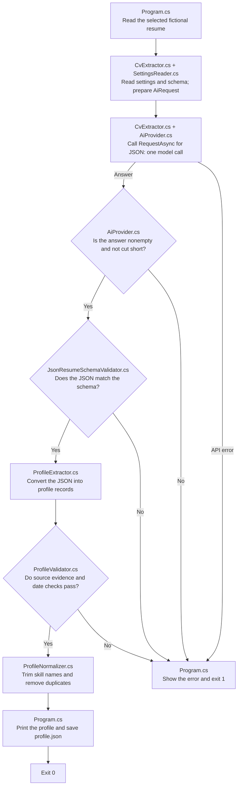

# Structured Output: one small experiment

Structured output means asking the AI to return information in a fixed format that your code can read and check. Here, the AI turns a fictional resume into a JSON profile with named fields such as `name` and `skills`. **Program.cs** follows the steps from reading the resume to saving the result. **CvExtractor.cs** asks the model for the profile. **JsonResumeSchemaValidator.cs** checks its JSON shape, **ProfileExtractor.cs** converts it into records, **ProfileValidator.cs** checks the facts against the resume, and **ProfileNormalizer.cs** cleans up supported skill names.

| File | Concept |
| --- | --- |
| [profile.schema.json](profile.schema.json) | Define which fields the JSON must contain and which kinds of values they accept. |
| [CandidateProfile.cs](CandidateProfile.cs) | Hold the accepted profile in C# records, with null for unknown facts. |
| [CvExtractor.cs](CvExtractor.cs) | Ask the AI to fill the profile using the resume's facts. |
| [JsonResumeSchemaValidator.cs](JsonResumeSchemaValidator.cs) | Check JSON syntax and the required field names and value types. |
| [ProfileExtractor.cs](ProfileExtractor.cs) | Convert the checked JSON into C# records. |
| [ProfileValidator.cs](ProfileValidator.cs) | Check supporting quotes, text facts, dates, and stated durations. |
| [ProfileNormalizer.cs](ProfileNormalizer.cs) | Trim supported skill names and remove duplicates. |

The instruction in CvExtractor.cs tells the AI to use only stated facts and leave unknown values as `null`. For example, if the resume gives no phone number, the profile's phone field should be `null`. A missing collection, such as a skills list, becomes an empty array. Each request starts a fresh agent run. Program.cs sends the returned JSON through the local checks before printing or saving it. You can change the resume or instruction to see how they affect the profile while the required JSON format stays the same.

## Execution flow

The model produces a proposed profile. The program checks it before printing or saving it. Follow the arrows to see where the AI request ends and the local checks begin.



The schema defines field names and value types. JsonResumeSchemaValidator.cs checks the JSON against it, and ProfileExtractor.cs converts the accepted JSON into C# records. ProfileValidator.cs then checks that the quoted text exists in the resume and contains the extracted facts. It accepts dates such as `2024`, `2024-01`, or `2024-01-31` without filling in a missing month or day. An end date that is certainly earlier than its start date is rejected.

Only a profile that passes these checks reaches skill cleanup and saving. ProfileNormalizer.cs trims skill names and keeps the first version of each name, ignoring case. A failed check stops the flow; missing input files or settings stop it before the request.

CvExtractor.cs declares its instructions, JSON Schema, and generation settings in an `AiRequest` and calls `AiProvider.RequestAsync`. The facade applies the same schema and settings for both providers. It also sends `provider.require_parameters=true` to OpenRouter so routing requires support for the requested parameters, and omits that routing option for Gemini. CvExtractor.cs contains no provider branch or SDK options. Both responses go through the same local schema and evidence checks.

The [shared retry policy](../../shared/shared/AiRetryPolicy.cs) can resend a temporary HTTP failure twice inside the agent call. It keeps the same schema, instructions, and resume. Local schema or evidence failures are not retried.

## Run

Install the .NET 10 SDK. All projects use one settings file: `shared/shared/.env` in the repository root. If it is missing, copy [shared/shared/.env.example](../../shared/shared/.env.example) to that path. Choose an AI provider with `AI_PROVIDER`, then configure its API key and model using the [shared setup instructions](../../shared/shared/README.md#run). Only the selected provider's values are required. Rebuild after changing the settings.

Then run from this folder:

```sh
dotnet run
```

You can also run the project in Visual Studio. Set `structured-output` as the startup project. A build copies the resumes, JSON schema, and shared settings into the folder containing the executable. The program reads those copies. Edit the original project files and rebuild to try your changes. The first build downloads the packages if needed.

[SettingsReader.cs](../../shared/shared/SettingsReader.cs) reads the copied settings file, and the facade in [AiProvider.cs](../../shared/shared/AiProvider.cs) sends the model request; Git ignores your `.env` file. Changing the selected provider or model requires no lesson code changes. CvExtractor.cs prints the selected model and provider. Each run makes **one model call**, normally one real HTTP request and at most **three HTTP attempts** with retries. They send the fictional resume to the selected AI provider and may charge your account. The call allows up to 4,096 output tokens, the small pieces of text counted by the model. Temperature controls variation in the generated text and is set to 0.1. The call has a 120-second total deadline, including retry waits and attempts.

Choose a model and provider that support JSON Schema structured output, temperature, and the output token limit. A schema describes the fields and value types the answer must contain. Gemini supports a subset of JSON Schema, so the selected model must accept this lesson's schema. If the request fails, the program prints the HTTP status and provider error message. HTTP 429 means the provider is limiting requests, has no remaining quota, or is too busy. Wait and try again, or check the quota and model in `shared/shared/.env`. After changing that file, stop any running debugging session and rebuild to copy the new settings.

## Understand the results

An empty answer or one cut short by the output limit is rejected. If the JSON or extracted values fail a check, the program reports where it failed and exits with code 1. A profile that passes the checks is printed and saved as `profile.json` beside the executable. The program prints the file's full path so you can find it. A failed request or validation check leaves a previously saved profile in place.

A message such as `HTTP 503. Retry 1/2 in 2.3 seconds.` means the shared policy will send the same request again. No retry message appears when the first attempt succeeds. See the [shared retry explanation](../../shared/shared/README.md#understand-the-results) for delays and failures after the attempt limit.

The profile uses `null` for unknown facts and arrays for `experience`, `education`, and `skills`. Each item's `evidence` gives a source filename and a supporting quote. Compare those quotes with the resume to understand where the values came from.

You still need to judge meaning: a quote mentioning a qualification does not prove the candidate earned it. The model can also give a different response when you repeat the same request.

## Learn by changing a prompt

1. Read [the resume](SampleData/resume.md). Predict which facts will become text, which will become lists, and which fields should be `null`.
2. Run the program and compare its profile with the resume and [the expected example](SampleData/profile.example.json). Look for a source quote supporting each extracted item.
3. Change `resumeFileName` at the top of Program.cs to `resume-ambiguous.md` and run again. The missing degree, phone, and skill proficiency should remain `null`. The ambiguous start date should also be `null`, and SQL should appear once.
4. Change one instruction in CvExtractor.cs and run again. Each run makes another model call, with up to three HTTP attempts. Observe which values change and which fields the schema still requires.

## Files to read

```text
Program.cs                                    Main extraction flow and selected resume
CvExtractor.cs                                Extraction instruction, schema, settings, and facade call
CandidateProfile.cs                           Typed records and nullable facts
JsonResumeSchemaValidator.cs                  JSON syntax and schema checks
ProfileExtractor.cs                           JSON conversion into typed records
ProfileValidator.cs                           Source facts, evidence, dates, and durations
ProfileNormalizer.cs                          Skill-name trimming and duplicate removal
profile.schema.json                           Required JSON structure
../../shared/shared/SettingsReader.cs         Shared provider selection and settings parsing
../../shared/shared/AiProvider.cs             Shared model-call facade, deadlines, checks, and API errors
../../shared/shared/AiRequest.cs              Request inputs and optional JSON schema
../../shared/shared/AiResponse.cs             Checked text, token usage, and request timing
../../shared/shared/AiRequestException.cs     API failures independent of SDK exception types
../../shared/shared/AiRetryPolicy.cs          Shared HTTP retries and retry messages
../../shared/shared/ProviderSettings.cs       Selected provider connection values
../../shared/shared.tests/AiProviderTests.cs  Shared facade request and response checks
../../shared/shared/.env                      Provider selection, keys, and models
../../shared/shared/.env.example              Template for creating the shared settings
SampleData/resume.md                         Complete fictional resume
SampleData/resume-ambiguous.md               Missing facts and an ambiguous date
SampleData/profile.example.json              Expected example profile
structured-output.csproj                      .NET 10 project, JSON validation dependency, and shared reference
```

Follow Program.cs from reading the resume to requesting, checking, and saving the profile. The printed JSON lets you inspect both the extracted facts and the quotes used to support them.

## Tests

The solution includes `structured-output.tests`, a small xUnit project with nine cases: seven local cases and two integration cases. Test files match the source files they check.

| Test file | Checks |
| --- | --- |
| [CvExtractorTests.cs](../structured-output.tests/CvExtractorTests.cs) | Two real model responses pass the complete schema, parsing, evidence, and normalization flow; unknown facts remain null. |
| [JsonResumeSchemaValidatorTests.cs](../structured-output.tests/JsonResumeSchemaValidatorTests.cs) | Malformed JSON and schema violations are rejected. |
| [ProfileExtractorTests.cs](../structured-output.tests/ProfileExtractorTests.cs) | The known example becomes typed records through the local acceptance flow. |
| [ProfileValidatorTests.cs](../structured-output.tests/ProfileValidatorTests.cs) | Source facts and exact quotes, explicitly stated durations, partial dates, chronology, and a valid call after a rejected profile. |
| [ProfileNormalizerTests.cs](../structured-output.tests/ProfileNormalizerTests.cs) | Skill names are trimmed and the first duplicate is preserved with its evidence. |

The integration tests call `CvExtractor.ExtractAsync`, just like the console app, and use the same settings and resumes copied into the test output folder through the project reference. [ProfileTestData.cs](../structured-output.tests/TestData/ProfileTestData.cs) supplies fresh records from those inputs. Tests that call the current validator share an xUnit collection so its static working state cannot overlap between classes. Common settings and response checks are tested separately in [shared.tests](../../shared/shared.tests/shared.tests.csproj).

From the repository root, run:

```sh
dotnet test 02-structured-output/structured-output.tests/structured-output.tests.csproj
```

You can also use Visual Studio's Test Explorer. A complete test run makes **two model calls**, normally two real HTTP requests and up to **six HTTP attempts** with retries. The integration tests check that the profile has a name and entries for experience, education, and skills, and keeps missing facts as `null`. The profiles appear in test output. Missing settings, API errors, and rejected model output fail the tests. A busy provider can cause a failure even when the code is working. Read the profile and its supporting quotes yourself to judge whether the facts mean what the AI claims.

References: [Microsoft Agent Framework structured output](https://learn.microsoft.com/en-us/agent-framework/agents/structured-outputs), [official OpenAI .NET SDK](https://github.com/openai/openai-dotnet), [OpenRouter structured output](https://openrouter.ai/docs/guides/features/structured-outputs), and [Gemini structured output](https://ai.google.dev/gemini-api/docs/structured-output).
