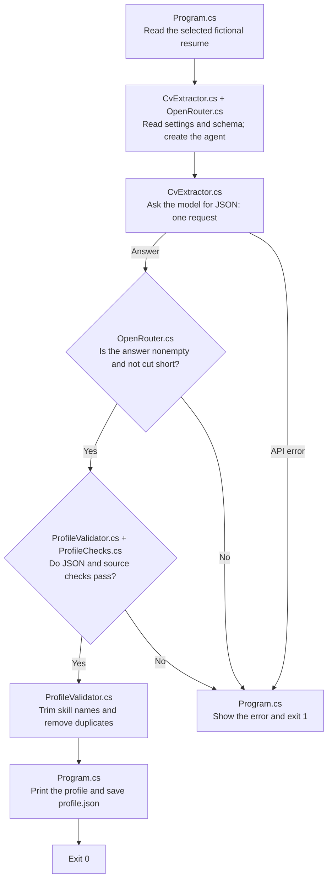

# Structured Output: one small experiment

Structured output means asking the AI to return information in a fixed format that your code can read and check. Here, the AI turns a fictional resume into a JSON profile with named fields such as `name` and `skills`. **Program.cs** follows the steps from reading the resume to saving the result. **CvExtractor.cs** asks the model for the profile, **ProfileValidator.cs** checks the JSON's shape, and **ProfileChecks.cs** checks the values against the resume.

| File | Concept |
| --- | --- |
| [profile.schema.json](profile.schema.json) | Define which fields the JSON must contain and which kinds of values they accept. |
| [CandidateProfile.cs](CandidateProfile.cs) | Hold the accepted profile in C# records, with null for unknown facts. |
| [CvExtractor.cs](CvExtractor.cs) | Ask the AI to fill the profile using the resume's facts. |
| [ProfileValidator.cs](ProfileValidator.cs) | Check the JSON format, run the fact checks, and remove duplicate skills. |
| [ProfileChecks.cs](ProfileChecks.cs) | Check supporting quotes, text facts, dates, and stated durations. |

The instruction in CvExtractor.cs tells the AI to use only stated facts and leave unknown values as `null`. For example, if the resume gives no phone number, the profile's phone field should be `null`. A missing collection, such as a skills list, becomes an empty array. Each request starts a fresh agent run. Program.cs sends the returned JSON through the local checks before printing or saving it. You can change the resume or instruction to see how they affect the profile while the required JSON format stays the same.

## Execution flow

The model produces a proposed profile. The program checks it before printing or saving it. Follow the arrows to see where the AI request ends and the local checks begin.



ProfileValidator.cs first checks the JSON shape and converts it into C# records. ProfileChecks.cs then checks the source quotes, extracted facts, and dates. A failure stops at that check. Only a profile that passes reaches skill cleanup and saving; missing input files or settings also stop the flow.

## Run

Install the .NET 10 SDK. All projects use one settings file: `shared/shared/.env` in the repository root. If it is missing, copy [shared/shared/.env.example](../../shared/shared/.env.example) to that path. Fill in your OpenRouter key and the ID of a model you can use, without quotes:

```dotenv
OPENROUTER_API_KEY=your-key
OPENROUTER_MODEL=your-model-id
```

Then run from this folder:

```sh
dotnet run
```

You can also run the project in Visual Studio. Set `structured-output` as the startup project. A build copies the resumes, JSON schema, and shared settings into the folder containing the executable. The program reads those copies. Edit the original project files and rebuild to try your changes. The first build downloads the packages if needed.

[OpenRouter.cs](../../shared/shared/OpenRouter.cs) reads the copied settings file; Git ignores your `.env` file. CvExtractor.cs prints the selected model. Each run makes **one real API request**, sending the fictional resume to OpenRouter and its remote provider. The request may charge your account. It allows up to 4,096 output tokens, the small pieces of text counted by the model. Temperature controls variation in the generated text and is set to 0.1. The request has a 120-second deadline, and automatic retries are disabled.

Choose a model and provider that support JSON Schema structured output. A schema describes the fields and value types the answer must contain. If the request fails, the program prints the HTTP status and provider error message. HTTP 429 means the provider is limiting requests or is too busy. Wait and try again, or change the model in `shared/shared/.env`. After changing that file, stop any running debugging session and rebuild to copy the new settings.

An empty answer or one cut short by the output limit is rejected. If the JSON or extracted values fail a check, the program reports where it failed and exits with code 1. A profile that passes the checks is printed and saved as `profile.json` beside the executable. The program prints the file's full path so you can find it. A failed request or validation check leaves a previously saved profile in place.

## Learn by changing a prompt

1. Read [the resume](sample-data/resume.md). Predict which facts will become text, which will become lists, and which fields should be `null`.
2. Run the program and compare its profile with the resume and [the expected example](sample-data/profile.example.json). Look for a source quote supporting each extracted item.
3. Change `resumeFile` at the top of Program.cs to `resume-ambiguous.md` and run again. The missing degree, phone, and skill proficiency should remain `null`. The ambiguous start date should also be `null`, and SQL should appear once.
4. Change one instruction in CvExtractor.cs and run again. Each run makes another request. Observe which values change and which fields the schema still requires.

The schema checks field names and value types. ProfileChecks.cs checks that the quoted text exists in the resume and contains the extracted facts. It accepts dates such as `2024`, `2024-01`, or `2024-01-31`, preserving the detail stated in the resume. An end date that is certainly earlier than its start date is rejected. ProfileValidator.cs then trims skill names and keeps the first version of each name, ignoring case. You still need to judge meaning: a quote mentioning a qualification does not prove the candidate earned it. The model can also give a different response when you repeat the same request.

## Tests

The solution includes `structured-output.tests`, a small xUnit project. [StructuredOutputTests.cs](../structured-output.tests/StructuredOutputTests.cs) contains seven cases. Two ask the real model to extract a profile; these integration tests call `CvExtractor.ExtractAsync`, just like the console app, and use the same settings and resumes copied into the test output folder through the project reference. Five local cases check a known example profile, invalid JSON and schema failures, source facts, partial dates and date order, and duplicate skills. Common settings and response checks are tested separately in [shared.tests](../../shared/shared.tests/shared.tests.csproj).

From the repository root, run:

```sh
dotnet test 02-structured-output/structured-output.tests/structured-output.tests.csproj
```

You can also use Visual Studio's Test Explorer. A complete test run makes **two real API requests**. The integration tests check that the profile has a name and entries for experience, education, and skills, and keeps missing facts as `null`. The profiles appear in test output. Missing settings, API errors, and rejected model output fail the tests. A busy provider can cause a failure even when the code is working. Read the profile and its supporting quotes yourself to judge whether the facts mean what the AI claims.

## Files to read

```text
Program.cs                                    Main extraction flow and selected resume
CvExtractor.cs                                Shared agent request and extraction instruction
CandidateProfile.cs                           Typed records and nullable facts
ProfileValidator.cs                           JSON schema checks and skill normalization
ProfileChecks.cs                              Source facts, evidence, dates, and durations
profile.schema.json                           Required JSON structure
../../shared/shared/OpenRouter.cs             Shared configuration, response checks, and API errors
../../shared/shared.tests/OpenRouterTests.cs  Shared plumbing checks in shared.tests
../../shared/shared/.env                      Your OpenRouter key and model
../../shared/shared/.env.example              Template for creating the shared settings
sample-data/resume.md                         Complete fictional resume
sample-data/resume-ambiguous.md               Missing facts and an ambiguous date
sample-data/profile.example.json              Expected example profile
structured-output.csproj                      .NET 10 project and pinned package dependencies
```

Follow Program.cs from reading the resume to requesting, checking, and saving the profile. The printed JSON lets you inspect both the extracted facts and the quotes used to support them.

References: [Microsoft Agent Framework structured output](https://learn.microsoft.com/en-us/agent-framework/agents/structured-outputs), [official OpenAI .NET SDK](https://github.com/openai/openai-dotnet), and [OpenRouter structured output](https://openrouter.ai/docs/guides/features/structured-outputs).
