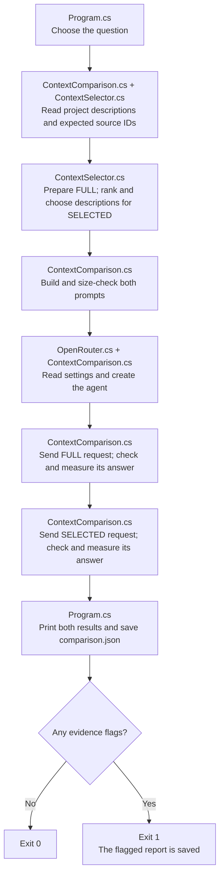

# Context Engineering: one small experiment

Context engineering means choosing the information the AI receives before it answers a question. This experiment reads six fictional project descriptions and asks the same question twice. **Program.cs** runs the comparison, **ContextSelector.cs** chooses the descriptions, **ContextComparison.cs** sends the requests, and **ContextEvidence.cs** checks the answer's citations and quotes.

| Context | Concept |
| --- | --- |
| FULL | Give the AI all six project descriptions, within the size limit. |
| SELECTED | Use words from the question to choose up to two matching project descriptions. |

For the default question, `Which project used PostgreSQL?`, FULL supplies projects P1-P6 and SELECTED supplies only P1, the PostgreSQL project. Choosing what the AI can read is the context engineering step in this lesson. The same system instruction in ContextComparison.cs tells both requests to use only the supplied facts, cite the project IDs, and quote supporting text exactly. The question, model, instructions, and generation settings stay the same; only the supplied descriptions change. Each request starts a fresh conversation, so the first answer does not influence the second.

## Execution flow

Both contexts are prepared and their prompts are checked before the first model request. FULL runs first, then SELECTED. Each call uses an independent conversation with the same question, instructions, model, and settings.



Ranking helps SELECTED choose the descriptions most likely to contain the answer. When several match, it gives the strongest matches priority within the two-description limit. ContextSelector.cs ranks them before calling the AI. It ignores common question words such as `which` and `project`. Each remaining distinct word scores 3 points for a heading match, otherwise 1 point for a match in the description. The code adds each project's points and selects up to two with positive scores, highest first. For `Which project used PostgreSQL?`, P1 ranks highest because PostgreSQL appears in its heading. Equal scores follow the original document order. If no words match, SELECTED contains no descriptions. This is local word matching and makes no extra model requests.

For each answer, OpenRouter.cs rejects empty or cut-short text, and ContextEvidence.cs checks citations and quotes. ContextComparison.cs keeps the answer with its measurements and any evidence flags. Flags allow the comparison to continue and are saved in the report. A missing input, oversized prompt, API error, or unusable response stops the flow before that final save.

## Run

Install the .NET 10 SDK. All projects use one settings file: `shared/shared/.env` in the repository root. If it is missing, copy [shared/shared/.env.example](../../shared/shared/.env.example) to that path. Fill in your OpenRouter key and the ID of a model you can use, without quotes:

```dotenv
OPENROUTER_API_KEY=your-key
OPENROUTER_MODEL=your-model-id
```

Then run from this folder:

```sh
dotnet run
```

You can also run the project in Visual Studio. Set `context-engineering` as the startup project. A build copies the project descriptions, practice questions with their expected source IDs, and shared settings into the folder containing the executable. The program reads those copies. Edit the original project files and rebuild to try your changes. The first build downloads the packages if needed. You can also run `dotnet restore` and `dotnet build` separately from this folder; these commands work in Windows PowerShell and on macOS/Linux.

[OpenRouter.cs](../../shared/shared/OpenRouter.cs) reads the copied settings file; Git ignores your `.env` file. ContextComparison.cs prints the selected model. Each run makes **two real API requests**, one for FULL and one for SELECTED, sending the fictional project text to OpenRouter and its remote provider. These requests may charge your account. Temperature controls variation in the generated text; it stays at 0.2 for both requests. Each allows up to 4,096 output tokens and has a 120-second timeout. Automatic retries are disabled.

Choose a model and provider that support Chat Completions, temperature, and the output token limit. If a request fails, the program prints the HTTP status and provider error message. HTTP 429 means the provider is limiting requests or is too busy. Wait and try again, or change the model in `shared/shared/.env`. After changing that file, stop any running debugging session and rebuild to copy the new settings.

Each context can contain at most 8,000 characters. The complete prompt, including the shared instruction, question, and packaged descriptions, can contain at most 12,000 characters. Both prompts are checked before the first API request. If either is too long, the program stops and asks you to shorten the input; it does not silently remove text. An empty answer or one cut short by the output limit is also rejected. Some reasoning models spend output tokens on thinking as well as on their final answer.

## Understand the results

The program prints the comparison and saves it as `comparison.json` beside the executable. It prints the file's full path so you can find it. The report records the selection rules, supplied and cited project IDs, prompt sizes, token estimates, provider token counts when available, request times, source recall, answers, and evidence flags. A flag is a message showing that an evidence check failed. Flagged results are saved for inspection, and the program exits with code 1. An API failure stops the comparison and leaves a previously saved report in place.

A token is a small piece of text counted by the model. The program estimates prompt tokens by dividing the prompt's character count by four and rounding up. This is a rough estimate: it leaves out extra information used to wrap chat messages, and the model may count tokens differently. Provider token counts are recorded when available; `null` means the provider did not report them. Source recall tells you how many expected project IDs were supplied, using [the practice questions](sample-data/questions.json). For the PostgreSQL question, supplying P1 gives 100% recall. This measures whether the needed source was included. If the question has no entry in that file or its expected ID list is empty, recall is not applicable.

A citation such as `[P1]` or `【P1】` points to a project description. ContextEvidence.cs checks that each cited project was supplied and that an exact quote from it appears in the answer. It flags missing citations, unknown or excluded IDs, and missing quotes. For the practice questions, it also checks whether the answer should have admitted insufficient evidence. These checks help you find problems, but you still need to read whether the quoted text supports the claims. The same inputs can produce different answers, and a smaller prompt does not guarantee a faster response.

## Learn by changing the context

1. Read [the fictional projects](sample-data/projects.md). Predict which description the AI needs to answer `Which project used PostgreSQL?`.
2. Run the program. FULL should contain P1-P6 and SELECTED should contain only P1. Compare the answers, their supporting quotes, the prompt sizes, and the request times. Both requests have the description needed to answer the question.
3. Change `question` at the top of Program.cs to `Which project used Kubernetes?` and run again. Then try `Which project used Salesforce?`. None of the descriptions mention Salesforce, so both answers should be `I don't have enough evidence to answer this question.`
4. Change one project description or the selection rule in ContextSelector.cs and run again. Each run makes another two requests. Observe which descriptions are selected and how the answer changes.

## Files to read

```text
Program.cs                                    Main comparison flow and selected question
ContextSelector.cs                            Markdown sections, keyword ranking, and context cap
ContextComparison.cs                          Agent requests and comparison measurements
ContextEvidence.cs                            Citation and exact-quotation checks
ComparisonReport.cs                           Fixture and exported report records
../../shared/shared/OpenRouter.cs             Shared configuration, response checks, and API errors
../../shared/shared.tests/OpenRouterTests.cs  Shared plumbing checks in shared.tests
../../shared/shared/.env                      Your OpenRouter key and model
../../shared/shared/.env.example              Template for creating the shared settings
sample-data/projects.md                       Six fictional project records
sample-data/questions.json                    Expected source IDs and an unsupported question
context-engineering.csproj                    .NET 10 project and pinned package dependencies
```

Follow Program.cs into ContextComparison.cs to see how the same question is sent with two different sets of descriptions. Use the console output and saved report to compare the answers, input sizes, and timings. The pinned packages are `OpenAI` 2.14.0, `Microsoft.Extensions.AI.OpenAI` 10.10.1, and `Microsoft.Agents.AI` 1.24.0. Tests use `Microsoft.NET.Test.Sdk` 18.10.1, `xunit` 2.9.3, and `xunit.runner.visualstudio` 4.0.1.

## Tests

The solution includes `context-engineering.tests`, a small xUnit project. [ContextTests.cs](../context-engineering.tests/ContextTests.cs) contains ten cases. Eight run locally and check project selection, size limits, citations and quotes, duplicate project IDs, and whether both prompts keep the same question. Two ask the real model to run the comparison; these integration tests call `ContextComparison.CompareAsync`, just like the console app, and use the same settings and sample files copied into the test output folder through the project reference. Common settings and response checks are tested separately in [shared.tests](../../shared/shared.tests/shared.tests.csproj).

From the repository root, run:

```sh
dotnet test 03-context-engineering/context-engineering.tests/context-engineering.tests.csproj
```

You can also use Visual Studio's Test Explorer. A complete test run makes **four real API requests**: two context choices for the PostgreSQL question and two for the unsupported Salesforce question. The comparison reports appear in test output. Missing settings, API errors, and rejected model output fail the tests. A busy provider can cause a failure even when the code is working. Read the answers and their quotes yourself to judge factual meaning.

References: [Microsoft Agent Framework agents](https://learn.microsoft.com/en-us/agent-framework/concepts/agents), [official OpenAI .NET SDK](https://github.com/openai/openai-dotnet), and [OpenRouter Chat Completions](https://openrouter.ai/docs/api/api-reference/chat/create-a-chat-completion).
