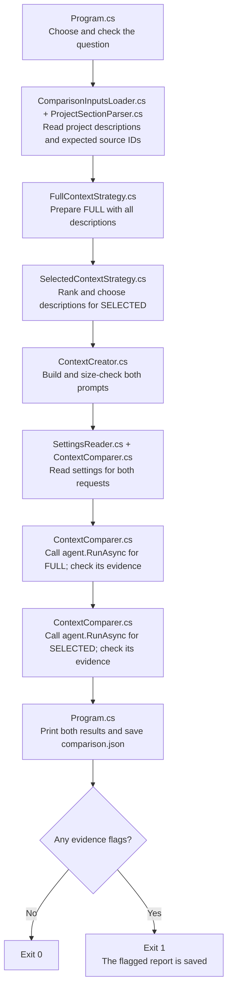

# Context Engineering: one small experiment

Context engineering means choosing the information the AI receives before it answers a question. This experiment reads six fictional project descriptions and asks the same question twice. **Program.cs** runs the comparison. **FullContextStrategy.cs** supplies every description, while **SelectedContextStrategy.cs** chooses descriptions that match the question. **ContextCreator.cs** packages both contexts into prompts. **ContextComparer.cs** sends both requests through the same steps, and **ContextEvidenceChecker.cs** checks each answer's citations and quotes.

| Context | Concept |
| --- | --- |
| FULL | Give the AI all six project descriptions, within the size limit. |
| SELECTED | Use words from the question to choose up to two matching project descriptions. |

For the default question, `Which project used PostgreSQL?`, FULL supplies projects P1-P6 and SELECTED supplies only P1, the PostgreSQL project. Choosing what the AI can read is the context engineering step in this lesson. The same system instruction in ContextCreatorHelpers.cs tells both requests to use only the supplied facts, cite the project IDs, and quote supporting text exactly. The question, model, instructions, and generation settings stay the same; only the supplied descriptions change. Each request starts a fresh conversation, so the first answer does not influence the second.

## Execution flow

Follow the arrows from top to bottom. Program.cs checks the question, calls ComparisonInputsLoader.cs to load the source files, and asks ContextCreator.cs to prepare both prompts. ProjectSectionParser.cs parses the document into sections, each with an ID, heading, and complete text. The two preparation calls are beside each other in `CreateContextStrategies`: FULL keeps every section, and SELECTED ranks and chooses matching sections. Both prompts are checked before Program.cs calls `CompareContextAsync` in ContextComparer.cs. For each context, that method creates a ChatClientAgent, declares the instructions and generation settings in ChatOptions, and calls RunAsync with the prepared prompt. It sends FULL first and SELECTED second and returns the report. Each call uses an independent conversation with the same question, instructions, model, and settings.



FullContextStrategy.cs keeps all sections in their original document order. SelectedContextStrategy.cs uses the question to choose a smaller set. Both return a `ContextStrategy` record containing the strategy name, included sections, and their combined text. ContextCreator.cs joins the section text without rewriting it and rejects a context that exceeds the size limit. It then builds each prompt and pairs it with its context in a `PreparedContext` record. The preparation files make no model requests.

Ranking helps SELECTED choose the descriptions most likely to contain the answer. When several match, it gives the strongest matches priority within the two-description limit. SelectedContextStrategy.cs keeps the keyword and ranking rules together. It ignores common question words such as `which` and `project`. Each remaining distinct word scores 3 points for a heading match, otherwise 1 point for a match in the description. The code adds each project's points and selects up to two with positive scores, highest first. For `Which project used PostgreSQL?`, P1 ranks highest because PostgreSQL appears in its heading. Equal scores follow the original document order. If no words match, SELECTED contains no descriptions. This is local word matching and makes no extra model requests.

For each answer, ContextComparer.cs checks the native finish reason and rejects empty or cut-short final assistant text. ContextComparer.cs reads native UsageDetails and measures RunAsync with Stopwatch. ContextEvidenceChecker.cs checks citations and quotes. ContextComparer.cs keeps the answer with its measurements and any evidence flags in the existing ComparisonReport records. Flags allow the comparison to continue and are saved in the report. A missing input, oversized prompt, API error, or unusable response stops the flow before that final save.

The [shared retry policy](../../shared/shared/Providers/AiRetryPolicy.cs) can resend a temporary HTTP failure twice inside each agent call. It keeps the same context and settings; it does not restart the comparison or repeat a completed context strategy.

## Run

Install the .NET 10 SDK. All projects use one settings file: `shared/shared/.env` in the repository root. If it is missing, copy [shared/shared/.env.example](../../shared/shared/.env.example) to that path. Choose an AI provider with `AI_PROVIDER`, then configure its API key and model using the [shared setup instructions](../../shared/shared/README.md#run). Only the selected provider's values are required. Rebuild after changing the settings.

Then run from this folder:

```sh
dotnet run
```

You can also run the project in Visual Studio. Set `context-engineering` as the startup project. A build copies the project descriptions, practice questions with their expected source IDs, and shared settings into the folder containing the executable. The program reads those copies. Edit the original project files and rebuild to try your changes. The first build downloads the packages if needed. You can also run `dotnet restore` and `dotnet build` separately from this folder; these commands work in Windows PowerShell and on macOS/Linux.

[SettingsReader.cs](../../shared/shared/SettingsReader.cs) reads the copied settings file, and [AiClientFactory.cs](../../shared/shared/AiClientFactory.cs) provides the clients used by the lesson's agents; Git ignores your `.env` file. Changing the selected provider or model requires no lesson code changes. ContextComparer.cs prints the selected model and provider. Each run makes **two model calls**, one for FULL and one for SELECTED: normally two real HTTP requests and at most **six HTTP attempts** with retries. They send the fictional project text to the selected AI provider and may charge your account. Temperature controls variation in the generated text; it stays at 0.2 for both calls. Each allows up to 4,096 output tokens and has a 120-second total deadline, including retry waits and attempts.

Choose a model and provider that support Chat Completions, temperature, and the output token limit. If a request fails, the program prints the HTTP status and provider error message. HTTP 429 means the provider is limiting requests, has no remaining quota, or is too busy. Wait and try again, or check the quota and model in `shared/shared/.env`. After changing that file, stop any running debugging session and rebuild to copy the new settings.

Each context can contain at most 8,000 characters. The complete prompt, including the shared instruction, question, and packaged descriptions, can contain at most 12,000 characters. Both prompts are checked before the first API request. If either is too long, the program stops and asks you to shorten the input; it does not silently remove text. An empty answer or one cut short by the output limit is also rejected. Some reasoning models spend output tokens on thinking as well as on their final answer.

## Understand the results

The program prints the comparison and saves it as `comparison.json` beside the executable. It prints the file's full path so you can find it. The report records the selection rules, supplied and cited project IDs, prompt sizes, token estimates, provider token counts when available, request times, source recall, answers, and evidence flags. A flag is a message showing that an evidence check failed. Flagged results are saved for inspection, and the program exits with code 1. An API failure stops the comparison and leaves a previously saved report in place.

A message such as `HTTP 503. Retry 1/2 in 2.3 seconds.` means the shared policy will send the same request again. No retry message appears when the first attempt succeeds. Measured request time includes retries and waits; provider token counts describe the returned answer, not the failed attempts. See the [shared retry explanation](../../shared/shared/README.md#understand-the-results) for delays and failures after the attempt limit.

A token is a small piece of text counted by the model. The program estimates prompt tokens by dividing the prompt's character count by four and rounding up. This is a rough estimate: it leaves out extra information used to wrap chat messages, and the model may count tokens differently. Provider token counts are recorded when available; `null` means the provider did not report them. Source recall tells you how many expected project IDs were supplied, using [the practice questions](SampleData/questions.json). For the PostgreSQL question, supplying P1 gives 100% recall. This measures whether the needed source was included. If the question has no entry in that file or its expected ID list is empty, recall is not applicable.

A citation such as `[P1]` or `【P1】` points to a project description. ContextEvidenceChecker.cs checks that each cited project was supplied and that an exact quote from it appears in the answer. It flags missing citations, unknown or excluded IDs, and missing quotes. For the practice questions, it also checks whether the answer should have admitted insufficient evidence. These checks help you find problems, but you still need to read whether the quoted text supports the claims. The same inputs can produce different answers, and a smaller prompt does not guarantee a faster response.

## Learn by changing the context

1. Read [the fictional projects](SampleData/projects.md). Predict which description the AI needs to answer `Which project used PostgreSQL?`.
2. Run the program. FULL should contain P1-P6 and SELECTED should contain only P1. Compare the answers, their supporting quotes, the prompt sizes, and the request times. Both requests have the description needed to answer the question.
3. Change `question` at the top of Program.cs to `Which project used Kubernetes?` and run again. Then try `Which project used Salesforce?`. None of the descriptions mention Salesforce, so both answers should be `I don't have enough evidence to answer this question.`
4. Change one project description or the selection rule in SelectedContextStrategy.cs and run again. Each run makes another two model calls, with up to six HTTP attempts. Observe which descriptions are selected and how the answer changes.

## Files to read

```text
Program.cs                                    Main comparison flow and selected question
ComparisonInputsLoader.cs                     Source loading and expected project IDs
ProjectSectionParser.cs                       Markdown headings, section text, and unique IDs
ContextCreator.cs                             Context text, prompt packaging, and size limits
ContextCreatorHelpers.cs                      Shared instruction, uncertainty response, and limits
ContextStrategies/FullContextStrategy.cs       All project sections in document order
ContextStrategies/SelectedContextStrategy.cs   Question keywords, ranking, and selected sections
ContextComparer.cs                            Request inputs, native agent calls and comparison measurements
ContextEvidenceChecker.cs                     Citation and exact-quotation checks
Types/ComparisonInputs.cs                     Question, source sections, and expected IDs
Types/ContextStrategy.cs                      Strategy name, included sections, and context text
Types/PreparedContext.cs                      Context paired with its complete user prompt
Types/ProjectSection.cs                       Parsed source ID, heading, and original text
Types/ComparisonReport.cs                     Fixture and exported report records
../../shared/shared/SettingsReader.cs         Shared provider selection and settings parsing
../../shared/shared/AiClientFactory.cs        Provider client construction and compatibility
../../shared/shared/Providers/AiRetryPolicy.cs  Internal bounded HTTP retry policy
../../shared/shared/ProviderSettings.cs       Selected provider connection values
../../shared/shared.tests/AiClientFactoryTests.cs  Native requests and provider compatibility
../../shared/shared/.env                      Provider selection, keys, and models
../../shared/shared/.env.example              Template for creating the shared settings
SampleData/projects.md                       Six fictional project records
SampleData/questions.json                    Expected source IDs and an unsupported question
context-engineering.csproj                    .NET 10 project, copied inputs, and shared reference
```

Start with Program.cs and follow its loading, preparation, and comparison calls. Read FullContextStrategy.cs and SelectedContextStrategy.cs side by side to see what changes between the contexts. The `ScoreSection` loop shows how each keyword contributes points. In ProjectSectionParser.cs, `ParseProjectSection` keeps heading checks, section reading, and duplicate-ID checks together. ContextCreator.cs prepares both contexts in `CreateContextStrategies`; its `PrepareContext` method builds and checks both prompts. Then read `CompareContextAsync` in ContextComparer.cs: `RunContextAsync` creates an agent and calls RunAsync once, and `CreateResult` names each measurement beside its value. Use the console output and saved report to compare the answers, input sizes, and timings. AI dependencies are pinned in [shared.csproj](../../shared/shared/shared.csproj). Tests use `Microsoft.NET.Test.Sdk` 18.11.0, `xunit` 2.9.3, and `xunit.runner.visualstudio` 4.0.1.

## Tests

The solution includes `context-engineering.tests`, a small xUnit project with twelve cases: ten local cases and two integration cases. Test files mirror the source names and folders, including the `ContextStrategies/` folder.

| Test file | Checks |
| --- | --- |
| [ContextStrategies/FullContextStrategyTests.cs](../context-engineering.tests/ContextStrategies/FullContextStrategyTests.cs) | The full context is accepted at its character cap and rejected above it. |
| [ContextStrategies/SelectedContextStrategyTests.cs](../context-engineering.tests/ContextStrategies/SelectedContextStrategyTests.cs) | Fixture selection, distinct keywords, heading priority, document-order ties, and the selected context cap. |
| [ProjectSectionParserTests.cs](../context-engineering.tests/ProjectSectionParserTests.cs) | Duplicate source IDs are rejected. |
| [ContextCreatorTests.cs](../context-engineering.tests/ContextCreatorTests.cs) | Both prompts retain the original question and source text; the complete prompt cap also catches JSON escaping overhead. |
| [ContextEvidenceCheckerTests.cs](../context-engineering.tests/ContextEvidenceCheckerTests.cs) | Unknown, excluded, and missing citations, exact quotes, and the explicit uncertainty response. |
| [ContextComparerTests.cs](../context-engineering.tests/ContextComparerTests.cs) | Two real comparisons check evidence, uncertainty, source recall, and prompt sizes. |

The integration tests load and prepare the inputs before calling `ContextComparer.CompareContextAsync`, just like the console app, and use the same settings and sample files copied into the test output folder through the project reference. [ContextTestData.cs](../context-engineering.tests/TestData/ContextTestData.cs) reads fresh local fixtures from those copied files. Common provider configuration and client behavior are tested separately in [shared.tests](../../shared/shared.tests/shared.tests.csproj).

From the repository root, run:

```sh
dotnet test 03-context-engineering/context-engineering.tests/context-engineering.tests.csproj
```

You can also use Visual Studio's Test Explorer. A complete test run makes **four model calls**: two context choices for the PostgreSQL question and two for the unsupported Salesforce question. This normally sends four real HTTP requests and can make up to **12 HTTP attempts** with retries. The comparison reports appear in test output. Missing settings, API errors, and rejected model output fail the tests. A busy provider can cause a failure even when the code is working. Read the answers and their quotes yourself to judge factual meaning.

References: [Microsoft Agent Framework agents](https://learn.microsoft.com/en-us/agent-framework/concepts/agents), [official OpenAI .NET SDK](https://github.com/openai/openai-dotnet), [OpenRouter Chat Completions](https://openrouter.ai/docs/api/api-reference/chat/create-a-chat-completion), and [Gemini OpenAI compatibility](https://ai.google.dev/gemini-api/docs/openai).
