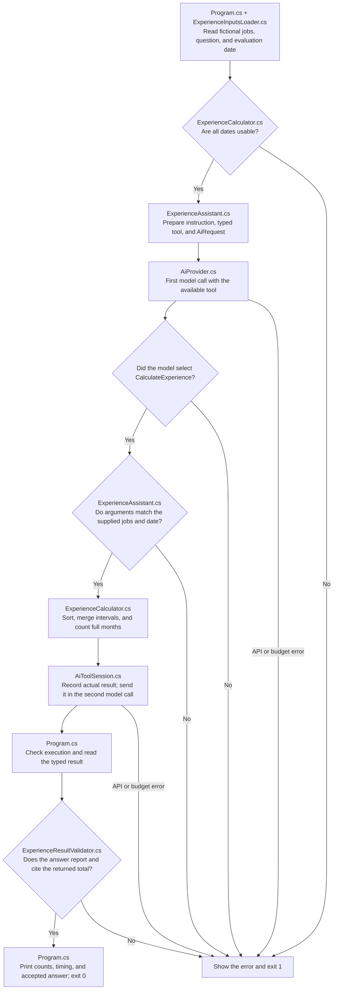

# Function Calling: one small experiment

Function calling lets an AI ask your application to run a C# method and then use its result. Here, the model answers a question about three fictional backend jobs by selecting `CalculateExperience`. C# merges overlapping work dates and counts full calendar months. **Program.cs** shows the main stages, **ExperienceAssistant.cs** declares the instruction, tool, and request settings, **ExperienceCalculator.cs** performs the arithmetic, and **ExperienceResultValidator.cs** checks that the final answer comes from a real tool execution.

| Path | Concept |
| --- | --- |
| Direct invocation | C# calls `ExperienceCalculator.CalculateExperience` with known arguments. Deterministic tests exercise this path without an API. |
| Agent-mediated invocation | The model requests the registered function. Agent Framework converts its arguments, executes C#, sends the structured result back, and obtains the final answer. |

Both paths use the same calculator and month-counting rule. The instruction tells the model to copy all supplied intervals and the explicit evaluation date, call the function exactly once, and cite `CalculateExperience.totalMonths`. The direct calculation is not supplied as a suggested answer. Change the dates to explore the arithmetic; keep them fixed when comparing the invocation paths. This lesson counts all supplied jobs rather than selecting roles from a resume.

## Execution flow

Follow the arrows from top to bottom. Preparation checks the source inputs before a paid request. Tool arguments are checked against those inputs because a model can return different dates even when its JSON looks valid.



Dates must be complete ISO dates such as `2024-02-01`. Each interval includes its start and excludes its end: February 1 to March 1 covers all of February. A month counts only when its entire calendar month is covered. January 15 to March 15 therefore counts February only. February 1 to February 29 excludes February's final day and counts zero months, even in a leap year. Equal start and end dates cover no time.

The calculator sorts intervals and merges overlaps, duplicates, and touching intervals before counting. Jobs covering January 1-15 and January 15-February 1 together cover one full January. A null `endDate` means a current role and requires the evaluation date declared in Program.cs. The program never uses today's date or invents missing date parts. The evaluation date replaces only missing end dates; completed jobs retain their stated end dates.

ExperienceAssistant.cs binds an ordinary C# callback to this run's original inputs. It rejects changed, omitted, added, or reordered intervals and a changed evaluation date. The shared facade uses `AIFunctionFactory.Create` to generate the argument schema from that callback's parameter types. Agent Framework performs the actual invocation loop. Tool choice is automatic, so a model that answers without a tool is detected rather than treated as success.

The loop allows at most two model calls and one local tool execution. It rejects unknown functions, malformed arguments, excessive function batches, truncated responses, and another tool request on the final turn. Function errors stop before a follow-up model request. The facade retains the original SDK assistant tool message so opaque provider fields, including Gemini thought signatures, survive the next turn.

Program.cs checks execution, converts the structured result into an `ExperienceResult`, and then checks the answer. Its deliberately small answer contract is `<integer> full calendar months [CalculateExperience.totalMonths].` The citation is literal text. Checking the complete sentence prevents additional unsupported totals from being accepted. Local check failures do not trigger repair requests.

## Run

Install the .NET 10 SDK. Use the repository's single settings file, `shared/shared/.env`, created from [shared/shared/.env.example](../../shared/shared/.env.example). Select OpenRouter or Gemini and fill in that provider's key and model using the [shared setup instructions](../../shared/shared/README.md#run). Rebuild after editing settings. Git ignores the credentials file.

From the repository root, these commands work in Windows PowerShell and macOS/Linux shells:

```sh
dotnet restore AIEngineeringTraining.slnx
dotnet build AIEngineeringTraining.slnx
cd 04-function-calling/function-calling
dotnet run
```

You can also select `function-calling` as the startup project in Visual Studio. The project reference carries shared settings into build output, and the project copies `SampleData/jobs.json` there. Inputs are read from `AppContext.BaseDirectory`, so the launch folder does not change which copies are used. Edit the original files and rebuild.

Running the application sends the question and fictional work intervals to the selected remote service: OpenRouter and its upstream provider, or Google's Gemini API through its OpenAI-compatible endpoint. It may charge your account. Restore, build, and deterministic tests do not make model requests. The application runs without command-line arguments; use the calculator tests for local arithmetic checks.

A successful run makes **one facade request containing exactly two model calls and one local tool execution**. This normally sends two HTTP requests and permits at most **six HTTP attempts** with the shared two-retry policy. Early failures can stop after zero, one, or two model calls. The shared **120-second deadline covers the entire conversation**, including both turns, local execution, retries, and waits. ExperienceAssistant.cs declares temperature 0.1 and a 2,048-token output limit for each turn. Model calls, local executions, and HTTP retries are different counts.

Choose a Chat Completions model that supports function tools and the declared generation settings. OpenRouter requests require parameter support; Gemini receives no OpenRouter routing option. The shared library keeps the existing pinned versions: Microsoft.Agents.AI 1.25.0, Microsoft.Extensions.AI.OpenAI 10.11.0, OpenAI 2.14.0, and System.ClientModel 1.16.0.

A missing or invalid reference date fails before an API request. Zero tool calls, unsupported tools, or a changed total or citation fail local checks. API errors use [AiProvider.cs](../../shared/shared/AiProvider.cs) to print the HTTP status and provider advice. For 401/403, check the selected key and permissions; for 402, check credits; for 404, check model availability; for 429 or 5xx, check quota or availability. A 400 can indicate unsupported settings or tools. The facade preserves the configured model and provider and uses the shared retries.

## Understand the results

The fictional jobs cover January 2020-July 2021, January 2021-January 2022, and April 2022 through the explicit April 2023 evaluation date. Summing jobs separately gives 42 months. The first two overlap for six months, so their merged coverage is 24 months. The current role contributes 12 more, giving **36 full calendar months** across two merged intervals.

A successful run includes:

```text
tool_name=CalculateExperience inputs=[redacted] duration_ms=15 succeeded=True
Input intervals: 3; merged intervals: 2
Model calls: 2; tool executions: 1
Request time: 2400 ms
36 full calendar months [CalculateExperience.totalMonths].
```

Durations vary. The trace records the function name, redacted inputs, duration, and success status. It does not print original work dates or exception contents. AiResponse also carries the actual structured result: `totalMonths`, `inputIntervalCount`, and `mergedIntervals`. Program.cs prints the accepted answer and measurements; it does not save an output file. Integration test output includes the fictional structured result for inspection.

Request time includes both model turns and retry waits. Tool duration measures local execution and result conversion. A message such as `HTTP 503. Retry 1/2 in 2.3 seconds.` means the shared policy is resending that HTTP request; it does not mean another calculation ran. Missing provider usage remains null in AiResponse.

The checks establish that the printed number matches an executed calculation over the supplied dates. You still decide whether those intervals represent the experience you intended to measure. The program does not extract dates from prose, infer job relevance, or establish that an employment claim is true.

## Learn by changing the dates

1. Read [jobs.json](SampleData/jobs.json). Calculate each job separately, then predict the overlap-adjusted total. Run and compare your prediction with the merged count and accepted answer.
2. Change one start date to the middle of a month and rebuild. Predict which whole calendar months remain covered after merging.
3. Change `evaluationDate` in Program.cs. The current role should use that exact date. Try an invalid date and observe that the program stops before a model request.
4. Read the direct calculator tests, then follow the same function through ExperienceAssistant.cs and the shared loop. Each successful run makes another two model calls, with at most six HTTP attempts.

## Files to read

```text
Program.cs                                      Question, evaluation date, and explicit acceptance flow
ExperienceInputsLoader.cs                       Copied input loading and checks before paid requests
ExperienceCalculator.cs                         Date validation, overlap merging, and month counting
ExperienceAssistant.cs                          Prompt, tool callback, source checks, settings, and facade call
ExperienceResultValidator.cs                    Real execution and exact total/citation checks
Types/ExperienceInputs.cs                       Original intervals and question inputs
Types/ExperienceResult.cs                       Merged intervals and structured calculation result
SampleData/jobs.json                            Three fictional backend work intervals
function-calling.csproj                         .NET 10 application, copied inputs, and shared reference
../function-calling.tests/                      Counterpart tests and fresh test fixtures
../../shared/shared/SettingsReader.cs           Shared settings loading
../../shared/shared/AiProvider.cs                Client, agent, routing, deadline, and API errors
../../shared/shared/AiRequest.cs                 Lesson request with optional tool configuration
../../shared/shared/AiResponse.cs                Text, usage, timing, model calls, and executions
../../shared/shared/AiToolCalling.cs             SDK-independent tool, budget, and execution records
../../shared/shared/AiToolSession.cs             SDK function loop, schemas, limits, and redacted tracing
../../shared/shared/AiRetryPolicy.cs             Bounded HTTP retries
../../shared/shared/.env.example                Shared credentials template
```

Start with Program.cs. Read the calculator for the local rule, then ExperienceAssistant.cs for how the model receives that function. Read the shared session when you want to inspect SDK plumbing. The main requirements map to the calculator for arithmetic, the assistant and shared session for tool use, the result validator for grounding, and counterpart tests for failures and limits.

## Tests

The project contains **31 cases: 30 deterministic cases and one live integration case**. Tests use Microsoft.NET.Test.Sdk 18.11.0, xunit 2.9.3, and xunit.runner.visualstudio 4.0.1.

| Test file | Checks |
| --- | --- |
| [ExperienceInputsLoaderTests.cs](../function-calling.tests/ExperienceInputsLoaderTests.cs) | Missing or invalid evaluation dates, empty questions, and missing intervals. |
| [ExperienceCalculatorTests.cs](../function-calling.tests/ExperienceCalculatorTests.cs) | Separate and overlapping jobs, current roles, leap dates, partial months, duplicates, touching intervals, unchanged inputs, and invalid chronology. |
| [ExperienceAssistantTests.cs](../function-calling.tests/ExperienceAssistantTests.cs) | Real agent invocation against local HTTP responses, source argument preservation, zero tool calls, invalid inputs preventing requests, and one complete live acceptance flow. |
| [ExperienceResultValidatorTests.cs](../function-calling.tests/ExperienceResultValidatorTests.cs) | Actual execution required; wrong totals, missing citations, extra claims, and unexpected execution records rejected. |

From the repository root, run local checks without credentials or API access:

```sh
dotnet test 04-function-calling/function-calling.tests/function-calling.tests.csproj --filter "Category!=Integration"
```

The in-memory transport supplies scripted responses while the actual SDK and Agent Framework build messages and execute the real calculator. It is a test dependency, not an application mode. These tests make **zero real API requests**. Shared tool declarations, routing, thought signature preservation, budgets, malformed calls, and independent sessions are tested in [AiProviderTests.cs](../../shared/shared.tests/AiProviderTests.cs).

Run the single real provider smoke test explicitly with:

```sh
dotnet test 04-function-calling/function-calling.tests/function-calling.tests.csproj --filter "Category=Integration"
```

Or run the complete project suite:

```sh
dotnet test 04-function-calling/function-calling.tests/function-calling.tests.csproj
```

Either command containing the integration case makes **two real model calls** on success, normally two HTTP requests and at most six HTTP attempts. It loads the same settings and jobs as the application, checks execution, reads the typed result, and validates the answer. Missing credentials, API errors, and rejected model output fail the test. The full repository suite also runs earlier integration tests; use `dotnet test AIEngineeringTraining.slnx --filter "Category!=Integration"` for local checks across all projects. All commands above work in PowerShell and macOS/Linux shells.

References: [Microsoft Agent Framework function tools](https://learn.microsoft.com/en-us/agent-framework/agents/tools/function-tools), [AIFunctionFactory.Create](https://learn.microsoft.com/en-us/dotnet/api/microsoft.extensions.ai.aifunctionfactory.create), [FunctionInvokingChatClient](https://learn.microsoft.com/en-us/dotnet/api/microsoft.extensions.ai.functioninvokingchatclient), [official OpenAI .NET SDK](https://github.com/openai/openai-dotnet), [OpenRouter tool calling](https://openrouter.ai/docs/guides/features/tool-calling), and [Gemini OpenAI compatibility](https://ai.google.dev/gemini-api/docs/openai).
