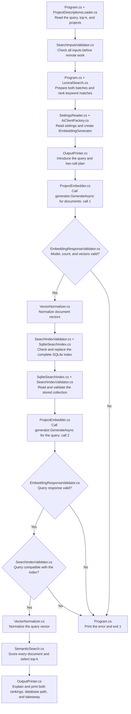
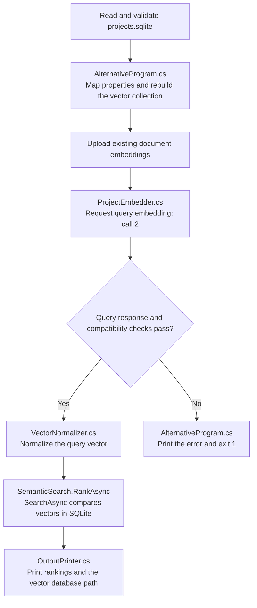

# Embeddings and Semantic Search: one small experiment

An embedding is a list of numbers that represents text. Texts with related meanings can have vectors pointing in similar directions. This experiment searches 12 fictional software project descriptions twice: once by meaning and once by matching words. **Program.cs** shows the complete flow, and **AlternativeProgram.cs** connects the same lesson to a SQLite vector-store collection. **ProjectEmbedder.cs** makes requests through Microsoft's common embedding interface, **EmbeddingResponseValidator.cs** checks the returned values, and **SemanticSearch.cs** and **LexicalSearch.cs** rank the same source texts. **OutputPrinter.cs** explains the comparison and presents the rankings, index details, and learning takeaway.

| Search | Concept |
| --- | --- |
| SEMANTIC | Compare query and project embeddings using cosine similarity. |
| KEYWORD | Count distinct query words found in each project's text, ignoring case and punctuation. |

For the query `experience building containerized APIs`, P01 describes ASP.NET Core services packaged as Docker images. That work may match the meaning without using the query's exact words. P06 is a proofreading project that repeats every query word but implements no software. P11, a garden budget spreadsheet, provides an unrelated control. The learner judges which projects really support the query.

Only the ranking method changes between the searches. The query, source text, and top-k stay fixed. Both methods search each project's original `text` field; the `skills` list is stored as metadata and adds no search terms. Embedding requests send text directly to an embedding model and return numbers. This lesson therefore needs no chat prompt or agent conversation.

## Execution flow

Follow the arrows from top to bottom. Program.cs loads every description, validates all inputs, and prepares both text batches before its first paid request. The query and top-k are constants at the top of that file. Top-k means the maximum number of results to return.



For AlternativeProgram.cs, the extra local stage sits between reading the snapshot and requesting the query:



SearchInputsValidator.cs accepts a nonempty query of up to 500 characters, a positive top-k, and 1-100 projects. Every project needs a unique ID, text of up to 4,000 characters, and demonstrated skill names. These limits bound input size; they do not estimate an exact price. Independent project errors are reported together with field paths. Missing files or invalid JSON stop loading immediately.

ProjectEmbedder.RequestAsync calls `IEmbeddingGenerator<string, Embedding<float>>.GenerateAsync` and returns Microsoft's `GeneratedEmbeddings<Embedding<float>>` result directly. This common interface serves the same role for embeddings that IChatClient serves for chat. Each result contains embedding vectors, model names, and any reported usage. EmbeddingResponseValidator.cs checks exactly one vector per input, every returned model name, consistent dimensions, finite numbers, and nonzero vectors. The vector size comes from the response. Validation and normalization remain separate visible stages.

AiClientFactory.cs returns a disposable generator using the selected provider. Its shared implementation creates the SDK client internally and uses Microsoft's standard `AsIEmbeddingGenerator` adapter. Before that adapter reads a response, Providers/EmbeddingResponseOrderPolicy.cs checks that the original indexes cover every returned vector exactly once and orders them by input position. This prevents a provider's response order from pairing a vector with the wrong project. The lesson uses only Microsoft.Extensions.AI types and needs no separate response parser.

Gemini can omit the numeric zero for the first embedding index. Its internal provider adapter restores that default only when one index is omitted and all positive indexes are present exactly once. This runs before the common index checks and ordering. Ambiguous omissions and invalid indexes still fail validation. This wire-format handling stays in shared code, so the lesson has no provider branch.

VectorNormalizer.cs gives each accepted vector length one. SemanticSearch.cs then computes cosine similarity with a dot product: multiply corresponding numbers and add them. It scores every row, so this is exact search rather than approximate nearest-neighbor search. Small rounding differences are expected with floating-point numbers. Both methods break equal-score ties by document ID using ordinal order and return at most top-k results, including zero keyword scores.

SemanticSearch.cs includes commented Microsoft tensor alternatives. `TensorPrimitives.Dot` replaces the entire coordinate loop when both vectors have length one. `TensorPrimitives.CosineSimilarity` also accounts for vector lengths. VectorNormalizer.cs shows a commented alternative using `TensorPrimitives.Norm` and `Divide`. These examples leave the default calculations unchanged. Their float operations can round differently from the current double intermediates, so recheck numerical limits before switching.

SqliteSearchIndex.cs stores provider, model, dimension, stable document IDs, original text, skills, and normalized vectors. All vectors belong to the collection's single model metadata record. One transaction replaces documents and metadata together. Repeating indexing creates no duplicates; changed or removed projects cannot leave stale rows. A failed replacement preserves the previous index. The program reads and validates the stored collection before checking that the query uses the same provider, model, and dimension.

AlternativeProgram.cs shows how to connect the same app to a vector store. It follows the same preparation, requests, checks, and SQLite snapshot stages. After reading the snapshot, it maps the existing VectorProject properties to a collection, configures cosine distance using the returned vector size, and uploads the project embeddings. It then calls SemanticSearch.RankAsync. That method calls `collection.SearchAsync`, so the SQLite connector compares the vectors and selects top-k. It filters by provider and model and converts cosine distance to similarity with `1 - distance`. No extra model calls are needed.

The alternative creates `project-vectors.sqlite` alongside the original `projects.sqlite` snapshot. It deletes and rebuilds only its derived vector collection on each run, so removed projects and a changed vector size cannot leave stale records. Deleting and uploading are separate operations: a failed upload can leave that collection incomplete. The original snapshot retains its transactional replacement behavior. The connector selects candidates before the C# tie sort, so equal scores at the top-k boundary can produce different project IDs from the manual full scan.

## Run

Install the .NET 10 SDK. All projects use `shared/shared/.env`. If it is missing, create it from [shared/shared/.env.example](../../shared/shared/.env.example). Choose `AI_PROVIDER=openrouter` or `AI_PROVIDER=gemini`, configure that provider's API key, and add its separate embedding model:

```text
# For AI_PROVIDER=openrouter
OPENROUTER_EMBEDDING_MODEL=openai/text-embedding-3-small

# For AI_PROVIDER=gemini
GEMINI_EMBEDDING_MODEL=gemini-embedding-001
```

Only the selected provider's embedding model and key are required here. Keep `OPENROUTER_MODEL` and `GEMINI_MODEL` for the existing chat lessons. Available models and account access can change; choose an embedding model your provider supports. Rebuild after editing the shared settings.

From this project folder, run:

```sh
dotnet run
```

To run AlternativeProgram.cs with the SQLite vector-store connector, use:

```sh
dotnet run --property:UseAlternativeProgram=true
```

This is an MSBuild property selecting which entry-point file is compiled. It is not an application argument. Plain `dotnet run` selects Program.cs. Both versions use the same sample data, shared settings, query, top-k, and two embedding calls. To compare a different query, change the constant in the entry point you run.

You can also select `embeddings-semantic-search` as the startup project in Visual Studio. The build copies SampleData/projects.json and the shared settings beside the executable. Inputs and `projects.sqlite` are resolved from AppContext.BaseDirectory. Edit the original files and rebuild. Generated output is inside the Git-ignored build folder.

Each successful run makes **two embedding model calls**: one batch for all 12 descriptions, then one for the query. The complete index is rebuilt on every run to keep the flow and call count predictable. Normally this sends two HTTP requests and at most **six HTTP attempts**. Each call has one 120-second deadline covering attempts and retry waits. The [shared retry policy](../../shared/shared/Providers/AiRetryPolicy.cs) permits two retries for temporary HTTP failures. The lesson adds no retries and never switches providers automatically.

Requests send fictional project text and the query to OpenRouter and its upstream provider, or directly to Google's Gemini API, and may charge your account. Keyword ranking, vector normalization, SQLite storage, and cosine ranking run locally. The application has no command-line flags or simulated mode. Tests use fake vectors or replace HTTP without contacting remote services. No Docker, Qdrant, Python, local model, or GPU is needed.

The application prints native SDK exceptions for rejected credentials, unavailable models, quota limits, and server failures. Local checks report malformed or incompatible responses. HTTP 400 can mean unsupported model features or request format; 401 concerns credentials, 402 payment, 404 an unavailable model, and 429 quota or request limits. Fix the reported settings or account problem and rebuild. A failed document response stops before the query request. A query failure can leave the new document index saved, but no search result is accepted.

The SQLite dependency is Microsoft.Data.Sqlite **10.0.13**, including its SQLite runtime through NuGet. The alternative adds CommunityToolkit.VectorData.SqliteVec **1.0.3-preview**, the preview SQLite connector for Microsoft's vector-store abstractions, and its native sqlite-vec extension. AI dependencies retain the versions in [shared.csproj](../../shared/shared/shared.csproj): OpenAI 2.14.0, Microsoft.Agents.AI 1.25.0, Microsoft.Extensions.AI.OpenAI 10.11.0, and System.ClientModel 1.16.0. [AiClientFactory.cs](../../shared/shared/AiClientFactory.cs) remains the shared AI entry point.

## Understand the results

The console prints the selected model and provider, query, indexed document count, dimension, top-k, database path, and both rankings. Every result has a rank, document ID, score, and a source snippet of up to 90 characters. Ranks start at one.

Each `Rank 1`, `Rank 2`, and later block shows the keyword result first, followed by the semantic result at that position. The two entries can refer to different project IDs.

In an interactive terminal, green marks headings, white marks rank dividers, cyan marks keyword search, and dark yellow marks semantic search. Provider, index, and usage details appear in grey. Excerpts use the terminal's default colour. OutputPrinter.cs keeps the lesson text and result formatting together, while the shared ConsoleOutput.cs helper prints headings and restores the original colour after each coloured message. Redirected output stays plain text, and the labels still identify each method.

Before the results, `Why use embeddings?` explains how `containerized APIs` can relate to `web services packaged as Docker images` despite different wording. This ability helps retrieve documents for retrieval-augmented generation (RAG), where an AI receives relevant source text before answering a question. This experiment demonstrates the retrieval step; it does not generate an answer from the results.

Cosine similarity ranges from -1 to 1: larger scores mean more similar vector directions. Keyword scores count distinct matching query words. P06 matches all four words of the default query and receives a keyword score of 4. Neither score is a probability, and their numeric scales differ. Compare which projects appear and their order, then read the full descriptions to judge relevance.

For example, one run with Gemini returned P04, P06, P01, P02, and P09 in the semantic top five. Keyword search returned P06, P03, P10, P01, and P02. P06 ranked highly under both methods despite describing proofreading. This illustrates why similarity alone does not prove someone performed the requested work. Other models or model updates can produce different rankings and scores.

The manual and vector-store versions can return the same ranking and scores rounded to four decimal places while their full-precision scores differ slightly. For a controlled comparison, give both search methods the same project and query vectors. Separate application runs each make their own embedding requests. Equal scores at the top-k boundary can still select different projects because the connector selects candidates before the C# ID sort.

The final takeaway explains when each method helps: keyword search for exact names, codes, and identifiers, and embedding search for related meanings expressed in different words. It also introduces hybrid search, which combines the two approaches. Hybrid search is a possible next step, not an implemented feature here: this program keeps the two rankings separate.

Provider input token counts are printed when available; missing usage remains `unavailable`. Tokens are the small text pieces counted by the model. A message such as `HTTP 503. Retry 1/2 in 2.3 seconds.` means the same request will be tried again. See the [shared retry explanation](../../shared/shared/README.md#understand-the-results).

The original database has IndexMetadata and Projects tables. Vectors are JSON lists in SQLite text columns. Program.cs loads and scores every row in C#; SQLite provides persistence rather than vector indexing. AlternativeProgram.cs also uploads those vectors to the connector's database and searches there. Its printed database path points to `project-vectors.sqlite`, where the connector maintains data and vector tables. Use the printed full path to inspect the file in a SQLite viewer. The code checks integrity and ranking mechanics. Relevance and evidence remain manual judgments; fake-vector tests do not evaluate a remote model's search quality.

## Learn by changing a query

1. Read [SampleData/projects.json](SampleData/projects.json). Predict where P01, P06, and P11 should rank for the default query, using their descriptions as evidence.
2. Run the comparison. Inspect the original descriptions behind both lists. Check whether the proofreading project ranks highly and which results describe actual deployment work.
3. Change `query` at the top of Program.cs to `deploying web services as Docker images`. Run again and inspect the changed keyword matches. Each run makes another two embedding calls, with up to six HTTP attempts.
4. Change `topK` to 3, or edit one fictional description, then run again. Inspect the new ranking and stored text. Replacing the complete index prevents old versions from remaining as extra rows.

## Files to read

```text
Program.cs                                      Complete flow, query, top-k, and presentation calls
AlternativeProgram.cs                           Optional entry point: map, upload, and search a vector collection
OutputPrinter.cs                                Search explanations, rank comparisons, details, and takeaway
ProjectDescriptionsLoader.cs                    JSON input loading
SearchInputsValidator.cs                        Complete input checks before remote work
ProjectEmbedder.cs                              Microsoft GenerateAsync request and per-call deadline
EmbeddingResponseValidator.cs                   Returned model, count, and vector checks
VectorValidator.cs                              Nonzero, finite, equal-size vector rules
VectorNormalizer.cs                             Normalize validated vectors to length one
SearchIndexValidator.cs                         Stored collection and query compatibility checks
SqliteSearchIndex.cs                            Transactional replacement and collection loading
SemanticSearch.cs                               Manual Rank, tensor examples, and vector-store RankAsync
LexicalSearch.cs                                Distinct-word ranking
Types/ProjectDescription.cs                     Fictional source record
Types/IndexedProject.cs                         Original project paired with its normalized vector
Types/SearchIndex.cs                            Stored provider, model, dimensions, and indexed projects
Types/SearchResult.cs                           Rank, document ID, score, and source snippet
SampleData/projects.json                        Twelve fictional project descriptions
embeddings-semantic-search.csproj                .NET 10 application, SQLite connector, and entry-point selection
../../shared/shared/SettingsReader.cs           Selected-provider embedding settings
../../shared/shared/AiClientFactory.cs          Common chat client and embedding generator construction
../../shared/shared/ConsoleOutput.cs            Shared headings and terminal colour handling
../../shared/shared/Providers/EmbeddingResponseOrderPolicy.cs  Raw index checks and input ordering
../../shared/shared/Providers/GeminiProvider.cs  Gemini omitted-zero index compatibility
../../shared/shared/Providers/AiRetryPolicy.cs   Internal bounded HTTP retries
../../shared/shared/.env.example                Shared settings template
```

Start with Program.cs and follow loading, validation, requests, normalization, storage, and ranking in execution order. Compare SemanticSearch.cs and LexicalSearch.cs to see what changes between the two searches. Then read AlternativeProgram.cs to see how the same embeddings enter a vector-store collection.

## Tests

Tests use Microsoft.NET.Test.Sdk 18.11.0, xunit 2.9.3, and xunit.runner.visualstudio 4.0.1. File names mirror the production counterparts.

| Test file | Checks |
| --- | --- |
| [ProjectDescriptionsLoaderTests.cs](../embeddings-semantic-search.tests/ProjectDescriptionsLoaderTests.cs) | Copied fictional corpus and representative controls. |
| [SearchInputsValidatorTests.cs](../embeddings-semantic-search.tests/SearchInputsValidatorTests.cs) | Query and corpus limits, top-k, duplicate IDs, and field errors. |
| [ProjectEmbedderTests.cs](../embeddings-semantic-search.tests/ProjectEmbedderTests.cs) | Original request text, cancellation, rejection before HTTP, and the complete live flow. |
| [EmbeddingResponseValidatorTests.cs](../embeddings-semantic-search.tests/EmbeddingResponseValidatorTests.cs) | Missing vectors, mixed model names, and inconsistent dimensions. |
| [VectorValidatorTests.cs](../embeddings-semantic-search.tests/VectorValidatorTests.cs) | Zero, nonfinite, and differently sized vectors. |
| [VectorNormalizerTests.cs](../embeddings-semantic-search.tests/VectorNormalizerTests.cs) | Known normalization of a 3-4-5 vector. |
| [SearchIndexValidatorTests.cs](../embeddings-semantic-search.tests/SearchIndexValidatorTests.cs) | Different models, providers, query dimensions, and corrupt stored vectors. |
| [SqliteSearchIndexTests.cs](../embeddings-semantic-search.tests/SqliteSearchIndexTests.cs) | Idempotent indexing, stale rows, metadata changes, and transaction rollback. |
| [SemanticSearchTests.cs](../embeddings-semantic-search.tests/SemanticSearchTests.cs) | Known cosine order, top-k, a fake-vector keyword comparison, and local SQLite connector filtering and cosine-distance conversion. |
| [LexicalSearchTests.cs](../embeddings-semantic-search.tests/LexicalSearchTests.cs) | Case, punctuation, repeated words, stable ties, and text-only matching. |

[TestData/EmbeddingTestData.cs](../embeddings-semantic-search.tests/TestData/EmbeddingTestData.cs) reads fresh copied inputs and supplies local HTTP responses. Shared factory and configuration checks stay in [shared.tests](../../shared/shared.tests/shared.tests.csproj), including Gemini's omitted-zero behavior. [EmbeddingResponseOrderPolicyTests.cs](../../shared/shared.tests/Providers/EmbeddingResponseOrderPolicyTests.cs) checks out-of-order response mapping, metadata preservation, and rejection of duplicate, missing, negative, and out-of-range indexes through Microsoft's real adapter. Database tests use unique temporary paths and clean up even after failures.

From the repository root, run deterministic checks with zero real API requests:

```sh
dotnet restore AIEngineeringTraining.slnx
dotnet build AIEngineeringTraining.slnx
dotnet test AIEngineeringTraining.slnx --filter "Category!=Integration"
```

Run this project's complete suite with:

```sh
dotnet test 05-embeddings-semantic-search/embeddings-semantic-search.tests/embeddings-semantic-search.tests.csproj
```

The complete project suite makes **two real embedding calls**, normally two HTTP requests and at most six HTTP attempts. Its single integration case follows the application's required loading, validation, preparation, requests, normalization, storage, and ranking sequence. It prepares the entire comparison before its first request. Provider failures or rejected output fail the test. These commands work in Windows PowerShell and macOS/Linux shells; Visual Studio Test Explorer can run the same tests.

References: [Microsoft.Extensions.AI embeddings](https://learn.microsoft.com/en-us/dotnet/ai/iembeddinggenerator), [official OpenAI .NET SDK](https://github.com/openai/openai-dotnet), [OpenRouter embeddings](https://openrouter.ai/docs/api/api-reference/embeddings/create-embeddings), [Gemini OpenAI compatibility](https://ai.google.dev/gemini-api/docs/openai#embeddings), [Microsoft.Data.Sqlite](https://learn.microsoft.com/en-us/dotnet/standard/data/sqlite/), and [SQLite vector-store connector](https://learn.microsoft.com/en-us/semantic-kernel/concepts/vector-store-connectors/out-of-the-box-connectors/sqlite-connector).
