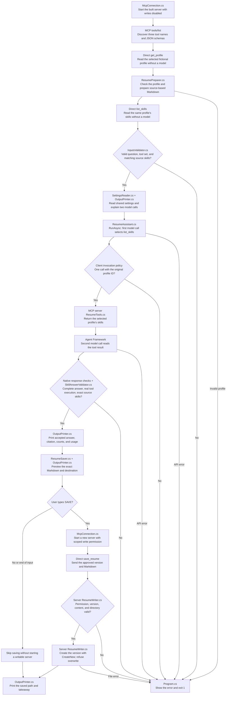

# Model Context Protocol: one small experiment

Model Context Protocol (MCP) lets an application discover and call tools in a separate program. Here, an agent asks a local resume server for Alex's fictional skills, such as C# and PostgreSQL. The server reads JSON and can save an approved Markdown resume. **Program.cs** shows discovery, direct invocation, the agent conversation, acceptance checks, and confirmation in order. **McpConnection.cs** starts the independently compiled server. **ResumeAssistant.cs** declares the agent and its native tool loop. **InputsValidator.cs** and **SkillAnswerValidator.cs** check the inputs and result. **ResumeSaver.cs** requires confirmation, and **OutputPrinter.cs** explains and prints each stage.

| Path | Concept |
| --- | --- |
| In-process function, as in project 04 | Agent Framework calls a C# method inside the client application. |
| Direct MCP call | The client sends a tool request to a separate server without involving a model. |
| Agent-selected MCP call | The model selects a discovered tool, Agent Framework invokes it over MCP, and the model reads its result. |
| Confirmed MCP save | The client previews exact source-based Markdown and starts a writable server only after the user types `SAVE`. |

The direct and agent paths use the same `list_skills` tool and the same selected profile. The agent receives the question and profile ID, not the direct skills result. Its instruction requires one tool call and an answer containing all returned skills in source order with `[list_skills]`. The experiment explores how a tool crosses a process boundary. It does not compare different prompts or models. Each agent run starts an independent conversation.

## Execution flow

Follow the arrows from top to bottom. Program.cs has discovery, conversation and checks, and confirmed-save chapters. A tool's JSON schema describes its argument names and types. Seeing that schema does not grant permission to execute the tool.



The server's Program.cs loads `SampleData/profiles.json` and calls ProfileValidator.cs before serving requests. It registers the official SDK with `AddMcpServer().WithStdioServerTransport().WithToolsFromAssembly()`. ResumeTools.cs marks `get_profile`, `list_skills`, and `save_resume` with the SDK's tool attributes. The first two select only known fictional profiles. STDIO means the server receives protocol messages on standard input and replies on standard output. All host logs and server presentation go to standard error so ordinary text cannot corrupt the protocol stream.

McpConnection.cs launches `dotnet` with an absolute path to the built `Server/mcp-server.dll`. It never runs a build inside the protocol stream. The client build copies the server's executable, runtime files, dependencies, and sample JSON into this folder. The two projects compile independently; the client does not call server classes in process. McpClient.CreateAsync starts and negotiates the connection. ListToolsAsync returns McpClientTool objects, which already implement Microsoft's AIFunction. ResumeAssistant.cs supplies those discovered tools directly, retaining their names and schemas.

ResumePreparer.cs checks the returned profile and builds Markdown by copying its facts. InputsValidator.cs checks the question, the exact three tool names, and agreement between the two direct source results before any model request. ResumeAssistant.cs creates ChatOptions and ChatClientAgent and calls RunAsync directly. A native FunctionInvokingChatClient invokes the MCP functions. Its per-run FunctionInvoker permits only `list_skills` with the original profile ID and rejects a second execution, including two requests in one model response. All three tools remain visible so the learner can distinguish discovery from authorization. No model argument can authorize `save_resume`.

The framework permits one tool round trip: a model call selects the tool and a second reads its result. A single linked CancellationTokenSource covers both turns, MCP execution, HTTP retries, and waits. The request rejects truncated or empty final text. SkillAnswerParser.cs selects the final assistant message rather than an earlier preamble. SkillAnswerValidator.cs checks two completed model calls, one successful matched tool result, and the exact source skills and citation. A plausible answer without tool execution fails. Local rejection never triggers a repair request.

After acceptance, every run offers a save. OutputPrinter.cs shows the actual Markdown and destination. ResumeSaver.cs reads the console response; only exact uppercase `SAVE` starts another server with `RESUME_MCP_ALLOW_WRITE=true` and an absolute `RESUME_MCP_VERSIONS_DIRECTORY`. Any other response, including end of input, skips saving. The agent's original server remains read-only. The save is a direct MCP invocation and makes no further model calls. The server checks permission independently even when a caller bypasses the client. These process variables configure the local file scope; they are not another credentials file.

ResumeWriter.cs accepts a version label consisting of `v` and 1–20 ASCII digits. It constructs the `.md` filename itself, preventing traversal, absolute paths, alternate streams, and caller-selected extensions. It rejects empty text and content over 16,384 UTF-8 bytes. It rejects a symbolic link or junction at the versions directory itself; its absolute parent path is trusted process configuration. FileMode.CreateNew refuses existing files or links without overwriting them. A canceled or failed write removes a partial file created by that operation. The console demo uses a UTC timestamp as the version label to make repeated runs convenient; even a duplicate timestamp cannot overwrite a file. This is a small local trust-boundary exercise, not an operating-system sandbox against a hostile process changing directories concurrently.

## Run

Install the .NET 10 SDK. Create the repository's single `shared/shared/.env` from [shared/shared/.env.example](../../shared/shared/.env.example). Select OpenRouter or Gemini and fill in that provider's key and chat model using the [shared setup instructions](../../shared/shared/README.md#run). Rebuild after changing settings. [AiClientFactory.cs](../../shared/shared/AiClientFactory.cs) owns provider connections and the common retry policy. The server needs no AI key and does not read this settings file.

From the repository root, the same commands work in Windows PowerShell and macOS/Linux shells:

```sh
dotnet restore AIEngineeringTraining.slnx
dotnet build AIEngineeringTraining.slnx
cd 07-mcp-server/mcp-client
dotnet run
```

In Visual Studio, open AIEngineeringTraining.slnx and choose **mcp-client** as the startup project. Its build also builds and copies mcp-server. Both applications resolve their copied inputs from AppContext.BaseDirectory. Change the source JSON or the profile ID in Program.cs and rebuild. Server data comes from its copied `SampleData/profiles.json`; generated versions live under the client's ignored `bin/.../data/versions/` directory.

There are no application command-line switches, simulated application modes, or separate credentials files. The normal run makes real model calls, as in the other lessons. Restore, build, and deterministic tests make none. Discovery and direct calls run before the client reads AI settings, so they still work with no credentials; the subsequent model stage then reports missing settings and stops. Use the local tests below to exercise discovery, direct invocation, and approved or rejected writes without any remote provider.

The actual server launch uses `dotnet` followed by one absolute DLL path. For example, these show the protocol process the client starts; they are not an interactive replacement for running the client:

```powershell
dotnet "D:\Repositories\ai-engineering-training\07-mcp-server\mcp-client\bin\Debug\net10.0\Server\mcp-server.dll"
```

```sh
dotnet "/absolute/path/ai-engineering-training/07-mcp-server/mcp-client/bin/Debug/net10.0/Server/mcp-server.dll"
```

No application arguments follow the DLL. Writes default to disabled when the server is launched directly. The trusted client supplies process settings for the approved save and closes each process through `await using` when its connection is finished. Do not start the server with `dotnet run` inside an MCP transport: build output could enter standard output. The learner runs only the client with `dotnet run`.

A successful run has **one agent run with exactly two model calls and one agent-selected MCP execution**. Before that, there are two direct MCP calls: `get_profile` and `list_skills`. An approved save adds one direct `save_resume` call. Discovery and protocol initialization are not model calls. Each model call permits at most two HTTP retries, so success normally uses two HTTP requests and permits at most **six HTTP attempts**. Early errors may stop after zero, one, or two model calls. The single conversation deadline is 120 seconds. Local preparation and an approved save each have their own bounded local-operation deadline; human thinking time is outside those deadlines.

ResumeAssistant.cs declares temperature 0.1 and a 2,048-token output limit per turn. Choose a chat model supporting function tools and those settings. The question, discovered tool descriptions and schemas, profile ID, and returned fictional skills are sent to OpenRouter and its upstream provider, or Google's Gemini API through its OpenAI-compatible endpoint. These calls may charge your account. The saved Markdown is built locally from source facts and is not sent to the model by the save stage.

The existing pinned AI dependencies remain Microsoft.Agents.AI 1.25.0, Microsoft.Extensions.AI.OpenAI 10.11.0, OpenAI 2.14.0, and System.ClientModel 1.16.0. This lesson adds ModelContextProtocol.Core 2.3.1 to the client and ModelContextProtocol 2.3.1 plus Microsoft.Extensions.Hosting 10.0.0 to the server. All target net10.0. No Docker, Python, local model, embedding service, or GPU is required.

Missing or invalid source data fails before a remote request. Missing settings stop after the local discovery demonstration. Native API and tool errors are printed by the entry point. For 401/403, check the selected key and permissions; for 402, check credits; for 404, check model availability; for 429 or 5xx, check quota or service availability. A 400 can indicate unsupported tools or settings. An empty or truncated answer fails the native response checks. A denied or failed save returns an MCP error and exits without claiming that a version was saved. The factory never silently switches providers or models.

## Understand the results

OutputPrinter.cs first shows three discovered tools with their descriptions and JSON argument schemas. The direct result for `alex` is `C#, .NET, PostgreSQL, Docker`. The model does not receive this list as part of its question. Its tool execution must obtain it again over MCP.

Green headings mark phases, white dividers number tools and answers from 1, cyan identifies source names, questions, and the accepted citation, and dark yellow identifies confirmation and skipped saving. Provider details, redacted execution logs, token usage, and saved paths appear in grey. Model answers and source-based Markdown use the default terminal colour. The shared ConsoleOutput.cs helper restores the original colour and leaves redirected output plain. The server uses its own STDERR printer because STDOUT is reserved for MCP.

A successful agent stage includes:

```text
SOURCE | get_profile, list_skills | profile=alex
SKILLS | C#, .NET, PostgreSQL, Docker
tool_name=list_skills inputs=[redacted] duration_ms=8 succeeded=True
Skills: C#, .NET, PostgreSQL, Docker [list_skills]
STATUS | Real MCP execution and exact source skills checked.
Model calls: 2; MCP tool executions: 1
```

Tool and request times vary. Request time covers the complete agent conversation, including tool work and retries. The tool timer measures only the agent-selected local MCP invocation. Token usage comes from native UsageDetails; omitted values are printed as `unavailable`. A retry message means an HTTP request is being resent, not that another MCP tool execution was approved.

The citation list maps `[list_skills]` to the selected profile's skills. The answer contract is deliberately narrow: `Skills: <comma-separated source skills> [list_skills]`. The checks establish actual execution and exact copying, not whether a person's qualifications are true or whether an arbitrary resume summary is useful.

The final preview contains the selected name, summary, and skills copied into Markdown. Type `SAVE` to create one version, or press Enter to decline. The printed path identifies the real saved file; a skipped save explicitly says that no writable server was started. No JSON results file is exported. Files under build output remain ignored by Git.

## Learn by changing the profile

1. Read [profiles.json](../mcp-server/SampleData/profiles.json). Predict the skills returned for `alex`, then run and compare the direct result with the agent answer and citation.
2. Change `profileIdString` in Program.cs to `sam` and rebuild. The schemas stay the same while the source facts and returned skills change. Each normal run makes another two model calls.
3. Run again and decline saving. Then run and type `SAVE` after inspecting the Markdown. Compare the server permission messages and look for the versioned file at the printed path.
4. Run the deterministic permission and filename tests. Follow a rejected direct `save_resume` request to ResumeWriter.cs: a tool name or an extra model argument cannot grant authorization.

## Files to read

```text
Program.cs                                     Discovery, direct calls, explicit acceptance stages, and save offer
OutputPrinter.cs                               Schemas, explanations, redacted trace, results, and confirmation preview
McpConnection.cs                               Absolute built-server launch, environment scope, and STDIO connection
InputsValidator.cs                             Question, three-tool contract, and agreement of source results
ToolResultParser.cs                            MCP IsError handling and JSON parsing
ResumePreparer.cs                              Profile reply checks and Markdown copied from its facts
ResumeAssistant.cs                             Discovered native tools, client policy, agent settings, and RunAsync
SkillAnswerParser.cs                           Final assistant text and model/tool counts
SkillAnswerValidator.cs                        Successful matched tool execution, exact skills, and citation
ResumeSaver.cs                                 Console confirmation and direct save through a new scoped server
Types/ResumeDraft.cs                           Selected profile, expected skills, and exact Markdown
Types/SkillAnswer.cs                           Parsed answer and completed-call counts
mcp-client.csproj                              .NET 10 client and copy of the independently built server
../mcp-server/Program.cs                        Validated sources, official MCP registration, and STDERR logging
../mcp-server/ResumeTools.cs                    Three attributed tools with generated argument schemas
../mcp-server/ResumeWriter.cs                   Independent permission, filename, byte-limit, and overwrite checks
../mcp-server/ServerSettings.cs                 Process-owned permission and absolute versions directory
../mcp-server/ProfileLoader.cs                  Copied JSON loading
../mcp-server/ProfileValidator.cs               Source fields and unique IDs
../mcp-server/OutputPrinter.cs                  Server diagnostics on STDERR only
../mcp-server/Types/                            Profile facts and saved filename records
../mcp-server/SampleData/profiles.json           Two fictional profiles
../mcp-client.tests/                            Client counterpart tests and isolated real STDIO fixtures
../mcp-server.tests/                            Source, write-safety, and raw protocol tests
../../shared/shared/SettingsReader.cs           Shared credentials and provider selection
../../shared/shared/AiClientFactory.cs          Provider connections and native IChatClient creation
../../shared/shared/ConsoleOutput.cs            Shared terminal headings and colours
../../shared/shared/Providers/AiRetryPolicy.cs  Bounded HTTP retries
../../shared/shared/.env.example                The repository's only credentials template
```

Start with Program.cs. Follow the discovered McpClientTool objects into ResumeAssistant.cs, then follow the native tool invocation into the separate server's ResumeTools.cs. Finish with the acceptance check and the two independent write gates.

## Tests

The client and server contain **50 test cases: 49 deterministic cases and one live provider integration case**, in separate xUnit projects. They use the repository's pinned Microsoft.NET.Test.Sdk 18.11.0, xunit 2.9.3, and xunit.runner.visualstudio 4.0.1. Local process tests are deterministic and do not carry the `Integration` category. That category is reserved for the single live provider smoke test.

| Test file | Checks |
| --- | --- |
| [McpConnectionTests.cs](../mcp-client.tests/McpConnectionTests.cs) | Real STDIO discovery, tool schemas, direct skills, independent server permission, scoped writes, and overwrite rejection. |
| [InputsValidatorTests.cs](../mcp-client.tests/InputsValidatorTests.cs) | Invalid questions, tool sets, and mismatched source skills send zero model requests. |
| [ResumePreparerTests.cs](../mcp-client.tests/ResumePreparerTests.cs) | Second-profile facts, rejection of a reply for a different profile, and null skill lists or entries. |
| [ToolResultParserTests.cs](../mcp-client.tests/ToolResultParserTests.cs) | MCP error results and malformed tool JSON. |
| [ResumeAssistantTests.cs](../mcp-client.tests/ResumeAssistantTests.cs) | Actual MCP invocation through the native agent, retained schemas, source IDs, one-tool budget, preamble exclusion, final response checks, cancellation, and the complete live acceptance flow. |
| [SkillAnswerValidatorTests.cs](../mcp-client.tests/SkillAnswerValidatorTests.cs) | Invented skills, missing citations, failed tool results, and unmatched call IDs. |
| [ResumeSaverTests.cs](../mcp-client.tests/ResumeSaverTests.cs) | Declined or missing confirmation starts no server; approved saving preserves the previewed text. |
| [ProfileLoaderTests.cs](../mcp-server.tests/ProfileLoaderTests.cs) | Both copied fictional source records and their skills. |
| [ProfileValidatorTests.cs](../mcp-server.tests/ProfileValidatorTests.cs) | Unchanged valid facts and grouped field errors. |
| [ServerSettingsTests.cs](../mcp-server.tests/ServerSettingsTests.cs) | Missing permission denies a real direct save; invalid permission values and relative output directories stop the isolated server at startup. |
| [ResumeWriterTests.cs](../mcp-server.tests/ResumeWriterTests.cs) | Write permission, traversal, absolute paths, invalid versions, alternate streams, overwrite prevention, UTF-8 byte limits, and cancellation. |
| [ProgramTests.cs](../mcp-server.tests/ProgramTests.cs) | Raw STDIO initialize and tool discovery contain only protocol JSON; diagnostics use STDERR. |

From the repository root, these commands work in PowerShell and macOS/Linux shells:

```sh
dotnet test 07-mcp-server/mcp-server.tests/mcp-server.tests.csproj
dotnet test 07-mcp-server/mcp-client.tests/mcp-client.tests.csproj --filter "Category!=Integration"
```

These tests make **zero real model requests** and need no credentials. They launch real .NET MCP server processes, isolate writes in fresh temporary directories, close transports, and clean up their files. Tests replace only the remote HTTP boundary with scripted Chat Completions responses; no simulated application mode is exposed. McpTestData.cs completes discovery, direct source loading, Markdown preparation, and input validation in the same order as Program.cs before an agent request.

[TestData/McpResponseHandler.cs](../mcp-client.tests/TestData/McpResponseHandler.cs) supplies scripted HTTP responses. [TestData/McpTestData.cs](../mcp-client.tests/TestData/McpTestData.cs) keeps source preparation separate from that transport.

Run the single provider smoke test explicitly:

```sh
dotnet test 07-mcp-server/mcp-client.tests/mcp-client.tests.csproj --filter "Category=Integration"
```

It uses the shared selected provider and model, makes **two real model calls** on success, and never saves a resume. It normally uses two HTTP requests and permits at most six HTTP attempts. Missing settings, provider errors, skipped tool use, and invalid output fail the test. Running the client test project without a category filter also includes this live case. A full solution test run includes all earlier projects' live cases; use `dotnet test AIEngineeringTraining.slnx --filter "Category!=Integration"` for repository-wide local checks.

References: [official MCP C# SDK](https://github.com/modelcontextprotocol/csharp-sdk), [Microsoft Agent Framework with MCP tools](https://learn.microsoft.com/en-us/agent-framework/agents/tools/local-mcp-tools), [MCP tools specification](https://modelcontextprotocol.io/specification/2025-11-25/server/tools), and [MCP transports](https://modelcontextprotocol.io/specification/2025-11-25/basic/transports).
