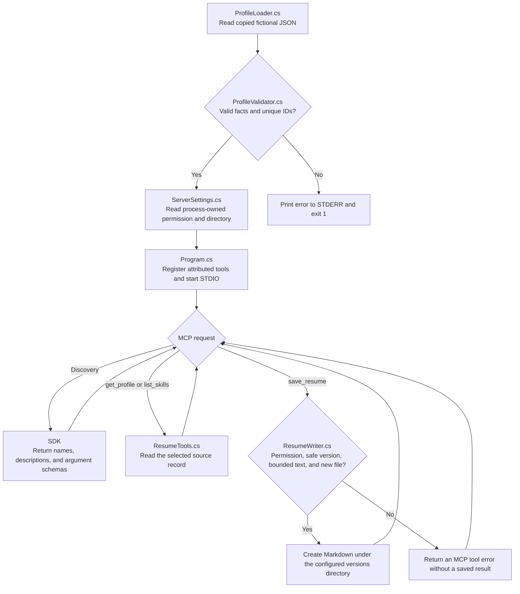

# MCP Server: one small experiment

An MCP server exposes tools that another application can discover and call through a common protocol. This process owns two fictional resume profiles and one optional output directory. **Program.cs** loads and validates the sources, registers the official MCP SDK, and starts its STDIO transport. **ResumeTools.cs** exposes three tools, **ResumeWriter.cs** checks write permission and file restrictions, and **OutputPrinter.cs** sends its short status message to standard error. Run the complete lesson through the [client](../mcp-client/README.md).

| Tool | Concept |
| --- | --- |
| `get_profile` | Read facts for one known fictional profile ID. |
| `list_skills` | Return that profile's skills without a model. |
| `save_resume` | Create a versioned Markdown file only when the process owner enabled writes. |

The server has no model prompt or AI dependency. The client agent's shared instruction requires the skills tool; the server independently applies the same source and file rules to every caller. Changing the selected profile changes the data while the tool schemas stay the same. Changing process permission changes whether writes are allowed, never their permitted destination or filename rules.

## Execution flow

Read top to bottom. Local validation finishes before the server accepts a protocol request.



The SDK derives JSON argument schemas from attributed C# methods. Process settings determine authorization; no tool argument supplies permission or a destination directory. ResumeWriter.cs allows only `v` followed by 1–20 digits, appends `.md` itself, and rejects empty or oversized content. Its limit is 16,384 encoded UTF-8 bytes. It rejects a linked versions directory and uses FileMode.CreateNew so an existing version cannot be overwritten. See the [client's execution flow](../mcp-client/README.md#execution-flow) for the console confirmation and local trust-boundary limits.

STDOUT contains only MCP JSON-RPC messages. Host logging and OutputPrinter.cs use STDERR. The shared ConsoleOutput.cs helper formats ordinary lesson output on STDOUT, so the client uses it while this protocol process keeps a separate STDERR printer. There are no remote requests or model response checks in this server; those stages belong to the client.

## Run

Install .NET 10 and run the [client commands](../mcp-client/README.md#run). Its build produces and copies this independent executable and its `SampleData/profiles.json`. In Visual Studio, select **mcp-client** as the startup project. Do not select the server for an interactive conversation: it expects protocol messages on standard input.

From the repository root, build only the server with the same PowerShell or macOS/Linux command:

```sh
dotnet build 07-mcp-server/mcp-server/mcp-server.csproj
```

The client launches `dotnet` with an absolute path to the built DLL; [Windows and Unix launch examples](../mcp-client/README.md#run) show the exact argument shape. The trusted client passes `RESUME_MCP_ALLOW_WRITE` and `RESUME_MCP_VERSIONS_DIRECTORY` as child-process environment variables. Permission defaults to false; the directory defaults to `data/versions/` under the server's build output. An explicitly supplied directory must be absolute. Inputs are read from AppContext.BaseDirectory rather than the launch folder. No server command-line switches are needed.

This project makes **zero model or embedding calls** and needs no credentials. Only the client reads the repository's single [settings template](../../shared/shared/.env.example) through shared helpers. [AiClientFactory.cs](../../shared/shared/AiClientFactory.cs) remains the only AI entry point for the client. Server packages are pinned to ModelContextProtocol 2.3.1 and Microsoft.Extensions.Hosting 10.0.0.

## Understand the results

The server's status message appears on STDERR and states its actual write permission. Its three schemas and successful results travel over STDOUT as protocol JSON and are presented by the client's OutputPrinter.cs. `get_profile` returns `id`, `name`, `summary`, and `skills`. `list_skills` returns a JSON list. A successful save returns `filename`, such as `v2.md`; the process never claims that a denied write succeeded.

Unknown profiles and rejected writes produce MCP tool errors. The client checks the reply's IsError flag before parsing it as accepted data. Source validation reports independent errors with paths such as `profiles[1].skills`. Invalid process configuration or missing source files prints an entry-point error to STDERR and exits with code 1.

Files are generated only under the configured versions directory. They contain the caller's approved Markdown, not verified qualifications. The server does not run a model, repair text, infer facts, or inspect arbitrary files.

## Learn by changing the source

1. Read [profiles.json](SampleData/profiles.json) and predict each profile's skills. Run the client and select the other source by changing its visible profile ID.
2. Add a skill to one profile, rebuild, and compare the direct result with the agent answer.
3. Use the server and client permission tests to compare disabled and approved writes. Keep the content fixed while changing authorization.
4. Inspect the filename tests before trying a repeated version. The original file must survive unchanged.

## Files to read

```text
Program.cs                              Validated preparation and official STDIO MCP hosting
OutputPrinter.cs                        Server status on STDERR only
ProfileLoader.cs                        Copied JSON loading
ProfileValidator.cs                     Source field checks and unique IDs
ServerSettings.cs                       Process-owned write permission and directory
ResumeTools.cs                          Three attributed server tools
ResumeWriter.cs                         Write authorization, safe names, byte limit, and create-only files
Types/ResumeProfile.cs                  Fictional facts with stable JSON names
Types/SavedResume.cs                    The saved filename result
SampleData/profiles.json                Two fictional resume records
mcp-server.csproj                       .NET 10 server, pinned SDK, and copied sources
../mcp-server.tests/                     Local source, file, and protocol checks
../mcp-client/README.md                  Complete experiment, run commands, model budget, and results
../../shared/shared/AiClientFactory.cs   Shared AI entry point used by the client
../../shared/shared/.env.example         Repository credentials template; unused by the server
```

## Tests

ProfileLoaderTests.cs checks copied records, ProfileValidatorTests.cs checks source facts and grouped errors, ResumeWriterTests.cs checks authorization and file restrictions, and ProgramTests.cs inspects raw STDOUT and STDERR during real protocol initialization and discovery. ServerSettingsTests.cs starts isolated server processes to check that omitted permission denies writes and that invalid permission values or relative versions directories stop startup. Each test sets only its child process's environment, so configuration cases can run independently. Tests isolate all writes in temporary directories and make **zero real API requests**.

From the repository root, use the same command on Windows and macOS/Linux:

```sh
dotnet test 07-mcp-server/mcp-server.tests/mcp-server.tests.csproj
```

The [client tests](../mcp-client/README.md#tests) additionally exercise these tools through a real official MCP client and test the separate console-confirmation gate. Only their explicitly categorized provider integration case contacts a model.

References: [official MCP C# SDK](https://github.com/modelcontextprotocol/csharp-sdk), [MCP tools specification](https://modelcontextprotocol.io/specification/2025-11-25/server/tools), and [MCP STDIO transport](https://modelcontextprotocol.io/specification/2025-11-25/basic/transports).
