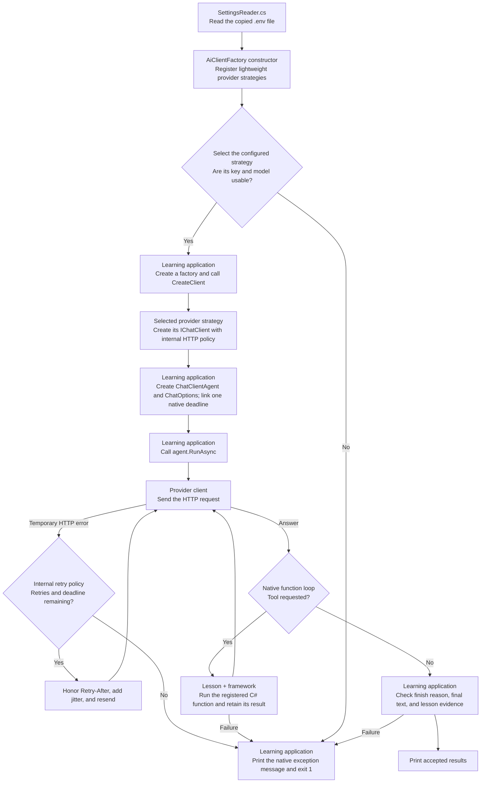

# Shared Plumbing: one small library

This library hides the connection differences between OpenRouter and Gemini while the learning applications use Microsoft Agent Framework directly. **AiClientFactory.cs** manually registers lightweight provider strategies in its constructor and selects one to create an IChatClient, the framework's common model-client interface. **Providers/OpenRouterProvider.cs** and **Providers/GeminiProvider.cs** own their names, configuration keys, endpoints, and provider-specific options. **SettingsReader.cs** uses those same registrations to read the selected connection into **ProviderSettings**. Each lesson creates its agent, declares its prompts and tools, calls RunAsync with native cancellation, and checks the native response itself.

| Method or value | Purpose |
| --- | --- |
| new AiClientFactory() | Register internal OpenRouterProvider and GeminiProvider strategy objects. |
| factory.CreateClient | Let the selected strategy create a disposable IChatClient. |
| SettingsReader.ReadSettingsAsync and ParseSettings | Read and check only the selected provider's key and model. |
| ProviderSettings | Hold the selected provider's connection values without printing credentials. |
| AiClientFactory.RequestTimeoutSeconds | Supply the common 120-second value for the SDK and each lesson's native deadline. |
| AiClientFactory.MaxRetries | Expose the two-retry limit without exposing the internal HTTP policy. |

The factory is the only shared AI entry point. Its constructor creates no SDK clients and needs no credentials. Only the selected strategy creates a client. Adding another provider means implementing an internal strategy and registering it in that constructor; existing lesson requests continue to use IChatClient. Both current strategies reuse the same internal OpenAI-compatible transport without combining their configuration details in the factory.

## Execution flow

Follow the arrows from settings to the selected provider, then through the lesson's own framework call. The factory selects inference clients; the lesson owns the agent and its conversation.



SettingsReader reads the provider's metadata from the registered strategy. OpenRouterProvider supplies https://openrouter.ai/api/v1 and the OPENROUTER configuration prefix. GeminiProvider supplies https://generativelanguage.googleapis.com/v1beta/openai/ and the GEMINI prefix. Configuration checks run before any remote request. Unknown providers are rejected; unused providers require no valid settings.

Both strategies use Providers/OpenAiCompatibleClient.cs to construct the OpenAI .NET SDK client with the selected model, credentials, endpoint, HTTP transport, and retry policy. For schema or tool requests, that adapter clones native options and creates fresh underlying options for each model turn. OpenRouterProvider adds provider.require_parameters=true; GeminiProvider supplies no routing extension. The adapter preserves opaque assistant tool metadata, including Gemini thought signatures returned directly or through OpenRouter, for the next turn.

Every lesson uses a native linked CancellationTokenSource and passes its token to the complete RunAsync call. Its CancelAfter uses AiClientFactory.RequestTimeoutSeconds. The same 120-second deadline covers model turns, local tools, attempts, and waits. The SDK network timeout uses the same value, without restarting the complete run's deadline. Final-answer and lesson-specific checks remain visible in the learning application.

The internal Providers/AiRetryPolicy.cs permits two retries for HTTP 408, 429, 500, 502, 503, and 504. It waits about 2 seconds before the first retry and 4 seconds before the second, plus 0-0.5 seconds of random variation called jitter. A longer Retry-After value takes priority. Cancellation stops requests and waits. Authentication, configuration, local validation, and network exceptions without an HTTP response are not retried. Retries neither restart the agent nor switch providers.

## Run

Install the .NET 10 SDK. Create .env in this folder from [.env.example](.env.example). It is the only source settings file, and Git ignores it.

Set AI_PROVIDER=openrouter with OPENROUTER_API_KEY and OPENROUTER_MODEL, or AI_PROVIDER=gemini with GEMINI_API_KEY and GEMINI_MODEL. Only the selected provider needs valid values. An absent AI_PROVIDER defaults to OpenRouter; blank and unsupported names are rejected.

From this folder, build the library:

```sh
dotnet build
```

shared.csproj copies .env into build output, and application/test project references carry that same file into their outputs. Rebuild after editing the original settings. This is a class library; use dotnet run from a learning application's folder or select that application as the Visual Studio startup project.

The shared project retains its pinned dependencies: OpenAI 2.14.0, Microsoft.Agents.AI 1.25.0, Microsoft.Extensions.AI.OpenAI 10.11.0, and System.ClientModel 1.16.0. Applications and tests use those dependencies through their shared project reference.

Building and running shared tests makes zero real model requests. A lesson sends fictional inputs to OpenRouter and its upstream provider, or directly to Google's Gemini API, and may charge your account. A model call normally sends one HTTP request and permits up to three attempts. Each lesson's README gives its exact call count.

Choose a model supporting the lesson's temperature and output limit. Structured output also needs its JSON Schema, and function calling needs function tools. Changing provider configuration keeps lesson code unchanged, but feature support and generated answers can differ. The strategies preserve the requested settings.

## Understand the results

SettingsReader returns ProviderSettings after checking the selected key and model for missing values and example placeholders. ProviderSettings.ToString shows only the provider name and model. Those local checks do not prove that credentials work or that a model is available; the actual request finds those problems.

CreateClient returns a disposable native IChatClient. AgentResponse, UsageDetails, and FunctionResultContent remain framework types used by the lessons. Missing token counts stay unknown. ContextComparer maps them into its existing report format. ExperienceAssistant configures its native function loop and iteration limit. Program.cs reads only the final assistant message before the execution and answer checks.

Each request method rejects empty final assistant text and ChatFinishReason.Length. The application prints native SDK exception messages for API failures and simple messages for local failures. Cancellation remains OperationCanceledException. There is no shared request, response, deadline, response-check, or error-presentation facade.

A retry prints a message such as HTTP 503. Retry 1/2 in 2.3 seconds. A successful first attempt prints no retry message. After two retries fail, the final SDK exception reaches the application. A long Retry-After wait can exhaust the complete run's deadline before another attempt.

## Learn by changing a check

1. Read ParseSettings in SettingsReader.cs. Predict what it does with a comment line, a quoted model name, and an equals sign inside a value.
2. Compare your prediction with [SettingsReaderTests.cs](../shared.tests/SettingsReaderTests.cs). These tests use made-up settings, so you can explore the parsing rules without a real API key.
3. Change one test input and run the shared tests. Observe why the settings or response are accepted or rejected.

## Files to read

```text
AiClientFactory.cs                               Manual strategy registration and selected-client creation
SettingsReader.cs                                Selected-provider configuration parsing and checks
ProviderSettings.cs                              Connection record with a credential-safe ToString
Providers/IAiProviderStrategy.cs                  Internal strategy contract returning IChatClient
Providers/OpenRouterProvider.cs                  OpenRouter configuration, endpoint, and routing extension
Providers/GeminiProvider.cs                      Gemini configuration and compatibility endpoint
Providers/OpenAiCompatibleClient.cs              Common SDK setup, native options, and tool metadata
Providers/AiRetryPolicy.cs                       Internal bounded HTTP retries and provider waits
shared.csproj                                    Provider SDK dependencies and copied settings
../shared.tests/AiClientFactoryTests.cs           Native requests, strategies, metadata, and cancellation
../shared.tests/SettingsReaderTests.cs            Configuration selection and parsing
../shared.tests/ProviderSettingsTests.cs          Credential-safe descriptions
../shared.tests/Providers/AiRetryPolicyTests.cs   Retry behavior through the SDK pipeline
.env                                             Provider selection, keys, and models
.env.example                                     Settings template
```

## Tests

Shared tests exercise registered provider strategies through the real SDK and framework with a local HTTP transport. They require no credentials and make zero real API requests.

| Test file | Checks |
| --- | --- |
| [AiClientFactoryTests.cs](../shared.tests/AiClientFactoryTests.cs) | Provider selection, rejection before HTTP, switching on one factory without option leakage, endpoints, native schemas/tools, thought signatures, usage, independent inputs, native errors, and cancellation. |
| [SettingsReaderTests.cs](../shared.tests/SettingsReaderTests.cs) | Selected-provider metadata, unused credentials, invalid selectors, missing values, and placeholders. |
| [ProviderSettingsTests.cs](../shared.tests/ProviderSettingsTests.cs) | Descriptions omit credentials. |
| [Providers/AiRetryPolicyTests.cs](../shared.tests/Providers/AiRetryPolicyTests.cs) | Request preservation, retry limits, permanent errors, Retry-After, cancellation, and synchronous SDK calls. |

From the repository root, run:

```sh
dotnet test shared/shared.tests/shared.tests.csproj
```

You can also use Visual Studio's Test Explorer. Retry tests record requested waits without sleeping. The learning applications retain their own native response checks. Function-calling tests check the native iteration limit, final answer, and calculator evidence.

References: [MSBuild project items and references](https://learn.microsoft.com/en-us/visualstudio/msbuild/common-msbuild-project-items), [official OpenAI .NET SDK](https://github.com/openai/openai-dotnet), [Agent Framework function tools](https://learn.microsoft.com/en-us/agent-framework/agents/tools/function-tools), [ClientRetryPolicy](https://learn.microsoft.com/en-us/dotnet/api/system.clientmodel.primitives.clientretrypolicy), [Gemini retry guidance](https://ai.google.dev/gemini-api/docs/troubleshooting#retry-strategy), and [Gemini OpenAI compatibility](https://ai.google.dev/gemini-api/docs/openai).
