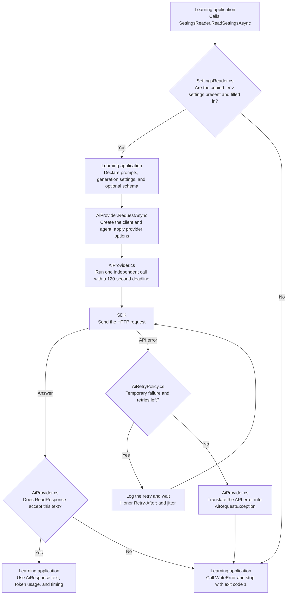

# Shared Plumbing: one small library

This library gives all three learning applications one way to call an AI model. A facade is a shared entry point that hides how an operation is carried out. Each lesson supplies an **AiRequest** with its prompts and generation settings. **AiProvider.cs** creates the client and agent, sends the request, and returns an **AiResponse**. It also handles provider options, deadlines, response checks, and API errors. **SettingsReader.cs** selects the provider and reads its connection values into **ProviderSettings**. **AiRetryPolicy.cs** retries temporary HTTP failures. For example, the structured-output lesson supplies its JSON schema without knowing how OpenRouter or Gemini receives it.

| Method or value | Purpose |
| --- | --- |
| SettingsReader.ReadSettingsAsync and ParseSettings | Select the provider and read its key and model from the copied .env file. |
| AiProvider.RequestAsync | Send one independent model request and return text, usage, and timing. |
| AiRequest and AiJsonSchema | Declare lesson inputs and an optional required JSON format without SDK types. |
| AiResponse and AiTokenUsage | Return checked text, available token counts, and request duration. |
| AiRequestException | Preserve an API failure's status and details without an SDK exception contract. |
| AiProvider.MaxRetries | Allow at most two retries after the first HTTP attempt. |
| ReadResponse | Return valid text unchanged; stop if the answer is empty or cut short. |
| AiProvider.RequestTimeoutSeconds | Set the common 120-second request deadline. |
| WriteError | Show the provider's error details and suggest what to check next. |

The learning applications call `RequestAsync` with the same request and response types for every supported provider. Changing `AI_PROVIDER` selects the matching key, model, and endpoint for every lesson. Changing its model setting also leaves lesson code unchanged. The current SDK and Agent Framework implementation lives inside shared/ and can be replaced there. Prompts, sample data, generation settings, schemas, and checks that teach each lesson stay in that lesson's project.

## Execution flow

The flow starts when a learning application reads the settings and passes an AiRequest to the facade. The library performs the model call and returns values the lesson can inspect.



The facade creates and disposes its client for each request and starts the agent without saved conversation history. Earlier questions and answers cannot enter a later comparison call. OpenRouter uses `https://openrouter.ai/api/v1`; Gemini uses Google's OpenAI-compatible endpoint at `https://generativelanguage.googleapis.com/v1beta/openai/`. For a request with AiJsonSchema, the facade applies the schema and strict output options. It adds `provider.require_parameters=true` only for OpenRouter. Retries resend the same HTTP request inside the SDK; they do not restart the agent or switch providers. A permanent error or a failure after the retries stops the lesson. Building the library or running its own tests makes zero real model requests.

AiRetryPolicy allows two retries for HTTP 408, 429, 500, 502, 503, and 504. It waits about 2 seconds before the first retry and 4 seconds before the second. Each wait adds 0-0.5 seconds of random variation, called jitter, so several clients are less likely to retry at the same instant. The SDK reads `Retry-After` headers, including dates; the policy waits at least that long when the provider asks for a longer delay. Cancellation and the lesson's 120-second deadline stop requests and waits. Authentication, configuration, and other HTTP errors are not retried, nor are local checks or network exceptions without an HTTP response.

## Run

Install the .NET 10 SDK. Create `.env` in this folder from [.env.example](.env.example). All learning projects use this one source settings file. Git ignores it so your credentials are not committed.

For OpenRouter, set `AI_PROVIDER=openrouter` and fill in `OPENROUTER_API_KEY` and `OPENROUTER_MODEL`. For direct Gemini access, set `AI_PROVIDER=gemini` and fill in `GEMINI_API_KEY` and `GEMINI_MODEL`. Use a model ID available to your account on that service. Once both providers have valid settings, change only `AI_PROVIDER` to switch every lesson, then rebuild. Only the selected provider requires a key and model; unused values may remain as placeholders. Existing `.env` files without `AI_PROVIDER` continue to use OpenRouter. A blank or unsupported selector is rejected.

From this folder, build the library:

```sh
dotnet build
```

shared.csproj copies `.env` into its build output folder. Because the applications and tests reference this library, they receive the same settings file in their output folders too. Rebuild after changing the source settings. This is a class library, so it has no console entry point to run on its own. To try a lesson, run `dotnet run` from that application's folder or select it as the startup project in Visual Studio.

Building this library makes no model requests. Running a lesson sends its prompts and fictional source text to OpenRouter and its upstream provider, or directly to Google's Gemini API, and may charge your account. Each application's README distinguishes model calls from HTTP attempts: one model call normally sends one request but can send up to three attempts with retries. All AI package references are in shared.csproj: OpenAI 2.14.0, Microsoft.Extensions.AI.OpenAI 10.11.0, Microsoft.Agents.AI 1.25.0, and System.ClientModel 1.16.0. The facade applies a 120-second total deadline to a model call, including all attempts and waits; the SDK network timeout also uses that value.

Choose a model that accepts the lesson's temperature and output token limit. The structured-output lesson also requires support for its JSON Schema. Gemini supports a subset of JSON Schema. Provider support can differ, so switching the configuration does not guarantee identical answers or feature support. The lessons keep their settings fixed rather than silently adjusting them for another model.

## Understand the results

SettingsReader.ReadSettingsAsync returns a `ProviderSettings` record with the provider's display name, key, model, and endpoint after checking that the selected key and model are filled in and are not example placeholders. `ToString()` shows only the name and model; it omits the key. This local check does not confirm that the key works or the model is available; the facade's API request finds those problems.

AiProvider.RequestAsync accepts the selected settings and an AiRequest. It returns an AiResponse containing checked text, optional AiTokenUsage, and LatencyMilliseconds. The duration covers the agent run, including HTTP attempts and retry waits, and excludes client creation. Missing token measurements remain null. The facade preserves the declared prompts, temperature, token limit, and schema when selecting a provider.

ReadResponse checks whether an answer is present and complete. It returns valid text exactly as received. This does not check whether the facts are correct; each lesson has its own source checks, and you still review the answer's meaning yourself.

If an API request fails, the facade throws AiRequestException with the HTTP status and available provider details. The lesson catches that shared exception and calls WriteError to print it with advice about what to check. Cancellation remains an OperationCanceledException, and an empty or truncated answer raises InvalidDataException. For authentication or model failures, check the key or model belonging to `AI_PROVIDER`. HTTP 403 can indicate missing access permissions, and HTTP 429 can indicate quota, rate limits, or a busy service. Read that message in the learning application's console.

Before a retry, the policy writes a message such as `HTTP 503. Retry 1/2 in 2.3 seconds.` to the error output. A successful first attempt prints no retry messages. After two retries fail, the application shows the last provider error. Retries may make additional paid requests and do not guarantee capacity will become available. A long `Retry-After` wait can use the remaining deadline and end in cancellation without another attempt.

## Learn by changing a check

1. Read ParseSettings in SettingsReader.cs. Predict what it does with a comment line, a quoted model name, and an equals sign inside a value.
2. Compare your prediction with [SettingsReaderTests.cs](../shared.tests/SettingsReaderTests.cs). These tests use made-up settings, so you can explore the parsing rules without a real API key.
3. Change one test input and run the shared tests. Observe why the settings or response are accepted or rejected.

## Files to read

```text
SettingsReader.cs                       Provider selection, settings parsing, and configuration checks
AiProvider.cs                           Model-call facade, provider options, responses, deadlines, and errors
AiRequest.cs                            Lesson request and optional JSON schema records
AiResponse.cs                           Checked text, token usage, and request duration records
AiRequestException.cs                   API status and details independent of the SDK
AiRetryPolicy.cs                        Bounded HTTP retries, provider delays, and retry messages
ProviderSettings.cs                     Selected provider, key, model, and endpoint
shared.csproj                           .NET 10 library, SDK and Agent Framework dependencies, and settings copy
../shared.tests/AiProviderTests.cs       Facade requests, provider options, responses, and failure checks
../shared.tests/SettingsReaderTests.cs   Provider selection and settings parsing checks
../shared.tests/ProviderSettingsTests.cs Settings descriptions that omit credentials
../shared.tests/AiRetryPolicyTests.cs    SDK pipeline retry and cancellation checks
../shared.tests/shared.tests.csproj     xUnit project referencing the library
.env                                    Provider selection, keys, and models
.env.example                            Settings template
```

## Tests

[shared.tests](../shared.tests/shared.tests.csproj) contains local tests in files that match the shared source files.

| Test file | Checks |
| --- | --- |
| [SettingsReaderTests.cs](../shared.tests/SettingsReaderTests.cs) | Parsing, the default OpenRouter selection, unused credentials, unsupported selectors, missing values, and unchanged placeholders. |
| [AiProviderTests.cs](../shared.tests/AiProviderTests.cs) | Selected endpoints and models, generation settings, exact prompts, independent calls, strict schemas, provider-specific routing, response guards, token usage, API errors, and cancellation. |
| [ProviderSettingsTests.cs](../shared.tests/ProviderSettingsTests.cs) | Settings descriptions omit credentials. |
| [AiRetryPolicyTests.cs](../shared.tests/AiRetryPolicyTests.cs) | Unchanged request bodies, recovery, exhaustion after three attempts, permanent errors, exponential delays, Retry-After seconds and dates, cancellation, successful first attempts, and synchronous calls. |

Facade tests run the same request implementation as applications against an in-memory HTTP handler. Only the transport is replaced; the SDK and agent still serialize requests and process responses. Retry tests also run the real SDK pipeline and record scheduled waits without sleeping. These common checks are tested here once for all the lessons.

From the repository root, run:

```sh
dotnet test shared/shared.tests/shared.tests.csproj
```

You can also use Visual Studio's Test Explorer. This test run makes **zero API requests**. It uses made-up settings and responses, so it can check the helpers without contacting a model.

References: [MSBuild project items and references](https://learn.microsoft.com/en-us/visualstudio/msbuild/common-msbuild-project-items), [official OpenAI .NET SDK](https://github.com/openai/openai-dotnet), [ClientRetryPolicy](https://learn.microsoft.com/en-us/dotnet/api/system.clientmodel.primitives.clientretrypolicy), [Gemini retry guidance](https://ai.google.dev/gemini-api/docs/troubleshooting#retry-strategy), and [Gemini OpenAI compatibility](https://ai.google.dev/gemini-api/docs/openai).
