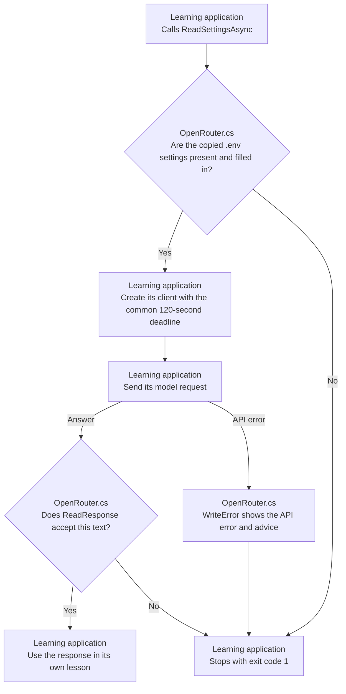

# Shared Plumbing: one small library

This library holds the setup and checks that all three learning applications need. Read **OpenRouter.cs** to see how they load the same settings, check returned text, use a request deadline, and display API errors. Each lesson keeps its own prompts and actual model request in its experiment source.

| Method or value | Purpose |
| --- | --- |
| ReadSettingsAsync and ParseSettings | Read your key and model from the copied .env file and check that both are filled in. |
| ReadResponse | Return valid text unchanged; stop if the answer is empty or cut short. |
| RequestTimeoutSeconds | Set the common 120-second request deadline. |
| WriteError | Show the provider's error details and suggest what to check next. |

The learning applications call these helpers before and after their model requests. For example, all three read the same key and model settings, and all three reject an empty answer. Keeping these checks in one library means a common check can be maintained in one place. The prompts, sample data, generation settings, and checks that teach each lesson stay in that lesson's project.

## Execution flow

The flow starts when a learning application calls this library. The application sends its own model request and uses the shared helpers around that request.



The library reads and checks settings, supplies the timeout value, and checks or explains responses. The model call belongs to the learning application. Building the library or running its own tests makes zero model requests.

## Run

Install the .NET 10 SDK. Create `.env` in this folder from [.env.example](.env.example), then fill in your OpenRouter key and model. All learning projects use this one source settings file. Git ignores it so your credentials are not committed.

From this folder, build the library:

```sh
dotnet build
```

shared.csproj copies `.env` into its build output folder. Because the applications and tests reference this library, they receive the same settings file in their output folders too. Rebuild after changing the source settings. This is a class library, so it has no console entry point to run on its own. To try a lesson, run `dotnet run` from that application's folder or select it as the startup project in Visual Studio.

Building this library makes no model requests. Each application's README tells you how many requests its experiment makes, which model features it needs, and how to understand failures.

## Learn by changing a check

1. Read ParseSettings. Predict what it does with a comment line, a quoted model name, and an equals sign inside a value.
2. Compare your prediction with [OpenRouterTests.cs](../shared.tests/OpenRouterTests.cs). These tests use made-up settings, so you can explore the parsing rules without a real API key.
3. Change one test input and run the shared tests. Observe why the settings or response are accepted or rejected.

ReadResponse checks whether an answer is present and complete. It returns valid text exactly as received. This does not check whether the facts are correct; each lesson has its own source checks, and you still review the answer's meaning yourself.

## Tests

[shared.tests](../shared.tests/shared.tests.csproj) contains three local tests in [OpenRouterTests.cs](../shared.tests/OpenRouterTests.cs). They check how settings are read, reject missing values or unchanged placeholders, and reject empty or unfinished responses. They also check that valid response text is preserved. These common checks are tested here once for all the lessons.

From the repository root, run:

```sh
dotnet test shared/shared.tests/shared.tests.csproj
```

You can also use Visual Studio's Test Explorer. This test run makes **zero API requests**. It uses made-up settings and responses, so it can check the helpers without contacting a model.

## Files to read

```text
OpenRouter.cs                        Shared helper methods and timeout
shared.csproj                        .NET 10 library and settings copy
../shared.tests/OpenRouterTests.cs   Three deterministic shared checks
../shared.tests/shared.tests.csproj  xUnit project referencing the library
.env                                 Your OpenRouter key and model
.env.example                         Settings template
```

References: [MSBuild project items and references](https://learn.microsoft.com/en-us/visualstudio/msbuild/common-msbuild-project-items).
